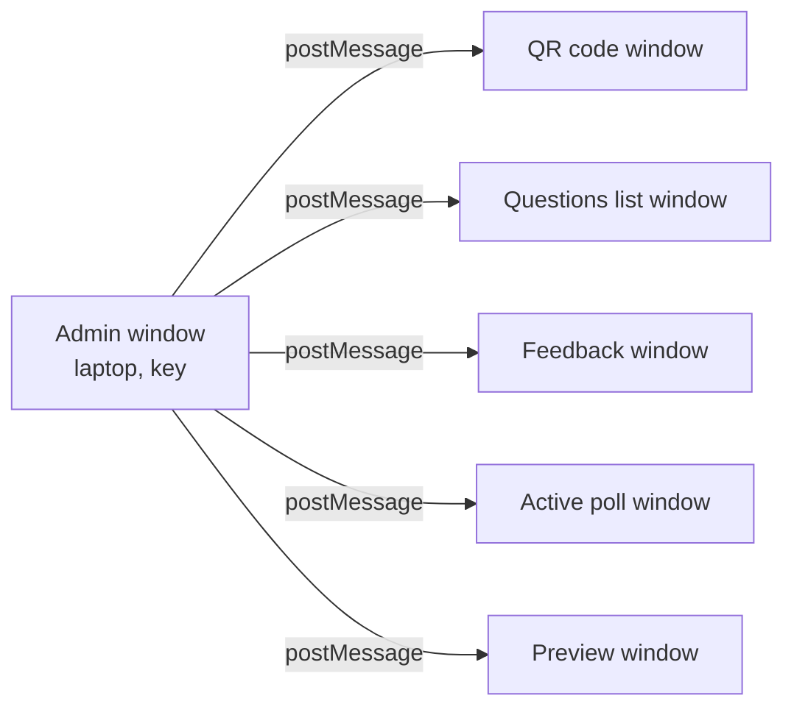
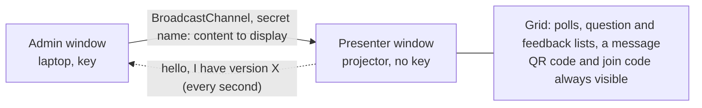

# Incident review: presenter display

[Suomi](poikkeama-esitysnaytto.md) · **English**

In the first real use during a lecture, the lecturer could not get questions, poll results or feedback onto the projector. This review explains what went wrong, why the automated tests did not notice, how it was fixed the same evening in two rounds, and how the fixes were tested. Fixes: PR #40 and #41.

## 1. What the user saw

> "Usability is really bad. Publishing questions to the screen does not work at all. I got the feedback on screen once. I could not show the answers (charts, word clouds) at all. Only one question can be open at a time."

Two new requirements came with the report: **several questions on screen at once**, as many as fit, and **answers already given must never be deleted**.

## 2. Root cause: one pop-up window per view

The admin window decrypts the answers in the lecturer's browser and sends the text to a separate presenter window on the projector. The presenter window holds no encryption key, which is a deliberate security design. The problem was the *number* of presenter windows.

Each window had to be dragged to the projector and made full screen. Four things combined:

1. **Windows hid each other.** The button for an already open window only tried to bring it to the front. On macOS a full-screen window lives in its own desktop space, so it often stayed behind another one. This explains why the feedback appeared once.
2. **The browser could block the pop-up.** The window was opened only after an asynchronous display query, and browsers allow pop-ups only directly from a click.
3. **Reloading broke the link for good.** The presenter window trusted only its opener (`window.opener`). After the admin page was reloaded, it was no longer recognised.
4. **Results were hidden by default**, and *Show results* applied to one question only, so it was unclear which button affected which screen.

The one-open-question limit was a separate, intentional design rule. Real use showed that it did not fit the teaching.

## 3. Why the tests did not catch it

Before the fix, the 80 browser test checks passed, including tests for exactly these views. The tests run in a headless Chrome, and the test script connects to each window directly through the browser's debugging protocol.

| In the test | In the lecture hall |
|---|---|
| No real display | Laptop, projector and Teams |
| Windows never overlap | Full-screen windows hide each other |
| Pop-ups are never blocked | The browser may block the pop-up |
| The script knows which window to read | A person must find the right window |
| The admin page is never reloaded | Reloads happen |

Each part worked and was tested. The whole did not work when one person used it in a real room. Only a trial with real devices reveals a usability failure like this.

## 4. The fix: one presenter window shown as a grid

- One button, *Open presenter display*, and a *● connected* status in the admin view.
- *+ On screen* adds a question next to the others. Up to 12 tiles, and the font size follows the tile size.
- Participants see every question on screen and can answer all open ones.
- The window opens directly from the click, so the browser does not block it.
- Every second the presenter window reports its version. If the admin view has a newer one, it sends it again, so reloading either window recovers on its own.
- *Clear answers* was removed from the live lecture controls. It exists only in preparation mode, behind a confirmation.
- The database change only adds a column, so the answers already given were kept.

## 5. Security review of the fix

The old design trusted "the window that opened me". The new channel needed another basis for trust, so the change was handled as a threat-model change ([threat model](threat-model.md)).

| Threat | Decision |
|---|---|
| Other pages on the same site | The app shares its web origin with the rest of the website. The channel name contains a random 128-bit secret (`crypto.getRandomValues`), so other pages cannot listen or send commands. |
| Secret leaking to logs | The secret travels in the URL fragment (`#…`), which the browser never sends to the server. |
| Key exposure | Unchanged: the presenter window has no key and no crypto library. |
| XSS | Content is validated and inserted only with `textContent`, never as HTML. |
| Decrypted data at rest | To survive a reload, only the id of the message on screen is stored, never its text. |
| Answering a hidden question | The server accepts an answer only for a question that is on screen and open. |

## 6. How the fix was tested

The most important new test, [`stage-multi.mjs`](../tests/e2e/stage-multi.mjs), was written straight from the failure report as a user story:

1. Two questions on screen, both open.
2. A participant answers both (multiple choice and word cloud).
3. Show results: bars and word cloud in the same window.
4. The feedback list as a third tile.
5. Measure at 1920×1080 and 1280×720: no overlap and nothing off screen.
6. **Reload the presenter window:** all tiles return.
7. **Reload the admin page:** the screen clears while the key is locked and returns after unlocking.
8. Remove a question from the screen: participants no longer see it, and its answer is still counted.

| Layer | Result |
|---|---|
| Unit and security tests | New tests for several open questions, removal from screen (answers kept) and the secret channel |
| Migration test | A database in the old format with answers is upgraded, and nothing is lost. Production already held the lecture's answers. |
| Browser tests | The whole suite passes, including the new story |
| CI pipeline | Secret scanning, static analysis (Semgrep, CodeQL), dependencies and SBOM (Trivy) and a dynamic scan (OWASP ZAP). ZAP first failed on a known tool fault with no findings, and it was re-run instead of skipped. |

It took 27 minutes from the report to production. That speed was possible only because the pipeline does the checks automatically.

## 7. Second round, the same evening

Two hours later the lecturer tried the fixed version in production: "It still doesn't work." The screen showed only a QR code.

1. **The large QR code covered everything.** Q had been pressed during the lecture to show the join code in large size. The setting is saved on the server, and the large QR is a layer on top of everything. It covered every new tile, and the admin view did not say so. **Fix:** content brought on screen hides the large QR, and the admin view warns while it is on.
2. **Answers were cut off.** An open question showed at most 10 answers, with no scrolling. **Fix:** the tile scrolls, the scrollbar is always visible, the position is kept on updates, and up to 50 answers are shown.

The second fix was in production 11 minutes after the report, with new tests. The lesson: **tests start from a clean state, but real users continue from where they left off last time.** Every automated test began with the large QR switched off; the lecturer began with the state left by the previous lecture.

## 8. What is still unproven

The new test runs in the same kind of headless browser as the old ones. It proves the logic and the layout, but not how windows behave on a real projector, in Safari or in a Teams share. The next lecture verifies that.

## 9. Lessons

1. **Green tests show that the parts work.** Plan a trial with real devices and with the state users left behind last time.
2. **Test what the user does, not what the code does.** Write the test from the failure report.
3. **Fewer moving parts is both a usability fix and a security fix.** One window is easier to use and to secure than five.
4. **A change of communication channel is a threat-model change.** Ask what the old design trusted and what replaces that trust.
5. **Protect the users' data during the fix.** Test the migration with old data before production.
