# HessuTalks-käyttöohje

**Suomi** · [English](user-guide.md)

HessuTalks on luennon kysymys-, palaute- ja kyselykanava. Osallistujat liittyvät puhelimella koodilla tai QR-koodilla,
kysyvät nimimerkillä ja vastaavat kyselyihin. Kaikki viestit ja vastaukset salataan osallistujan laitteessa, ja vain
luennoitsija voi lukea ne.

Ohjeen kuvissa punainen kehys osoittaa kuvatun painikkeen tai alueen. Kehyksen numero viittaa kuvan alla olevaan listaan.

**Sisältö**

1. [Käyttöönotto](#1-käyttöönotto)
2. [Luennon luominen](#2-luennon-luominen)
3. [Kysymysten valmistelu](#3-kysymysten-valmistelu)
4. [Osallistujan näkymä](#4-osallistujan-näkymä)
5. [Luennolla: kysymykset näytölle](#5-luennolla-kysymykset-näytölle)
6. [Tulokset ja moderointi](#6-tulokset-ja-moderointi)
7. [Osallistujien kysymykset ja palaute](#7-osallistujien-kysymykset-ja-palaute)
8. [Puhelinohjain](#8-puhelinohjain)
9. [Asetukset ja kirjautuminen](#9-asetukset-ja-kirjautuminen)
10. [Pikanäppäimet](#10-pikanäppäimet)

Hallinta on aina suomeksi. Osallistujan sivut ja projektorin tekstit ovat suomeksi tai englanniksi luennon kielen mukaan.

## 1. Käyttöönotto

Käyttöönotto tehdään kerran. Tarvitset käyttöönottotunnuksen, joka tulostuu, kun ylläpitäjä luo asetustiedoston,
ja laitteen, joka tukee passkeyta (esim. Touch ID, Face ID, Windows Hello tai turva-avain).

### 1.1 Ota hallinta käyttöön

Avaa osoite `…/admin`.

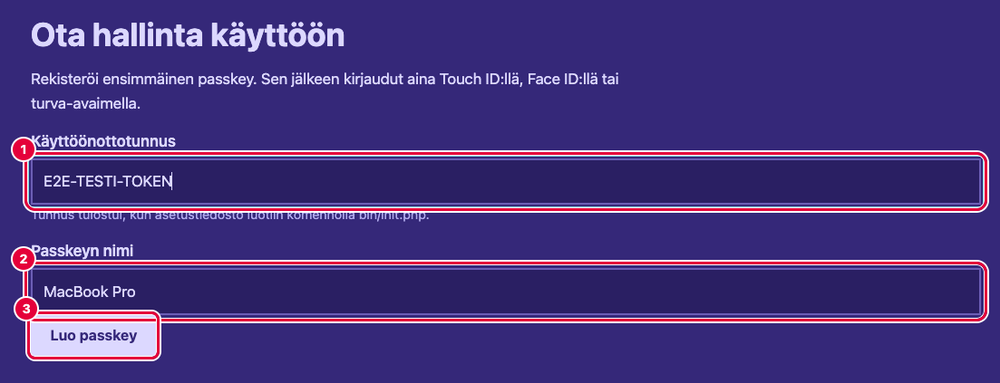

1. **Käyttöönottotunnus**: liitä tunnus tähän.
2. **Passkeyn nimi**: laitteen nimi, josta tunnistat passkeyn myöhemmin (esim. *MacBook Pro*).
3. **Luo passkey**: selain pyytää vahvistamaan sormenjäljellä, kasvoilla tai PIN-koodilla. Salasanaa ei ole.

### 1.2 Luo salausavaimet

Viestit salataan julkisella avaimella. Ne voi avata vain yksityisellä avaimella, joka suojataan tunnuslauseella.

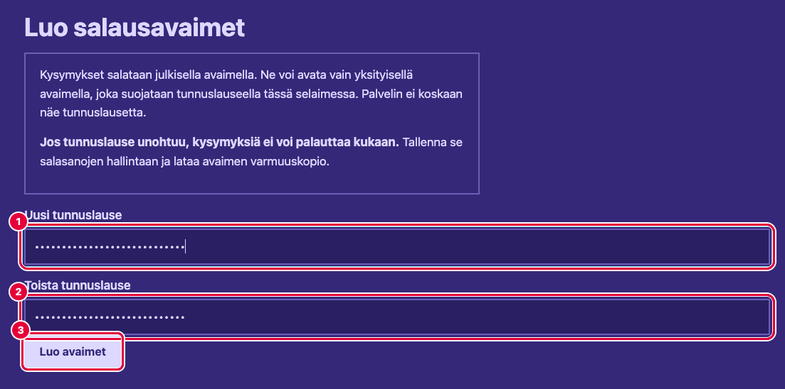

1. **Uusi tunnuslause**: vähintään 12 merkkiä. Tallenna se salasanojen hallintaan.
2. **Toista tunnuslause**.
3. **Luo avaimet**: selain lataa avaimen varmuuskopion. Säilytä se turvassa.

> **Tärkeää:** jos tunnuslause ja varmuuskopio katoavat, viestejä ei voi avata kukaan. Palvelin ei koskaan näe tunnuslausetta.

## 2. Luennon luominen

### 2.1 Uusi luento

1. **Uuden luennon nimi**: näkyy osallistujille.
2. **Kysymykset auki**: kuinka kauan osallistujat voivat lähettää viestejä (3 tuntia, vuorokausi, viikko tai kunnes suljet).
3. **Osallistujien kieli**: *English*, *Suomi* tai selaimen kielen mukaan. Osallistuja voi silti vaihtaa kieltä.
4. **Luo luento**: avaa luennon sivun.

Yksi luento voi kattaa koko kurssin: osallistujat käyttävät samaa koodia ja nimimerkkiä kaikilla kerroilla.

### 2.2 Luennon sivu: koodi ja QR-koodi

1. **QR-koodi**: näytä se diassa tai projektorilla. Osallistujat liittyvät skannaamalla sen.
2. **Liittymiskoodi**: kuusi merkkiä, jotka voi kirjoittaa etusivulle.
3. **Linkki** osallistujan sivulle. Avaa se, jos haluat nähdä osallistujan näkymän.
4. **Sulje kysymykset**: osallistujat eivät voi enää lähettää viestejä. Saman napin nimi on suljetulla luennolla *Avaa kysymykset*.
5. **Poista luento**: poistaa luennon ja kaikki sen viestit pysyvästi.
6. **Osallistujien kieli**: voit vaihtaa kielen myöhemmin. Myös projektorin tekstit vaihtuvat.

### 2.3 Työkalupalkki

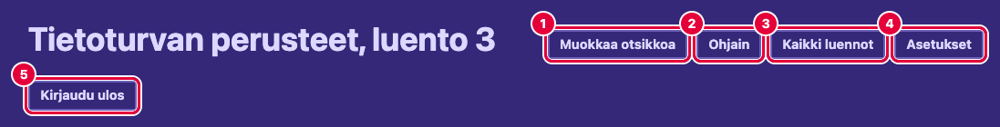

1. **Muokkaa otsikkoa**: korjaa luennon nimen. Koodi ja QR-koodi pysyvät samoina, joten diojen linkit toimivat edelleen.
2. **Ohjain**: puhelinohjain (ks. [luku 8](#8-puhelinohjain)).
3. **Kaikki luennot**: luentolista.
4. **Asetukset**: passkeyt, salausavain ja tietoturvaloki (ks. [luku 9](#9-asetukset-ja-kirjautuminen)).
5. **Kirjaudu ulos**.

1. Kirjoita uusi otsikko.
2. **Tallenna otsikko**.

### 2.4 Luentolista

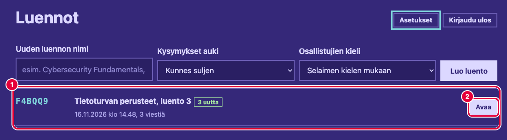

1. Luennon rivillä näkyvät koodi, nimi, uusien viestien määrä, luontiaika ja viestien määrä.
2. **Avaa**: luennon sivu.

## 3. Kysymysten valmistelu

Luennon kysymykset ovat **kysymyssarjoissa**, esimerkiksi yksi sarja moduulia tai luentokertaa kohden.
Valmistele sarjat ennen luentoa **Valmistelu**-tilassa.

### 3.1 Valmistelun työkalut

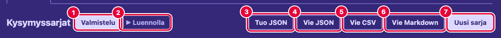

1. **Valmistelu**: sarjojen ja kysymysten luonti ja muokkaus.
2. **▶ Luennolla**: luennon aikainen tila (ks. [luku 5](#5-luennolla-kysymykset-näytölle)).
3. **Tuo JSON**: sarjat tiedostosta (ks. [3.5](#35-tuonti-ja-vienti)).
4. **Vie JSON**: kaikki sarjat tiedostoon, esimerkiksi seuraavaa toteutusta varten.
5. **Vie CSV**: tulokset taulukkona (Excel avaa suoraan).
6. **Vie Markdown**: raportti luennosta: kysymykset, tulokset ja osallistujien viestit.
7. **Uusi sarja**.

### 3.2 Uusi kysymyssarja

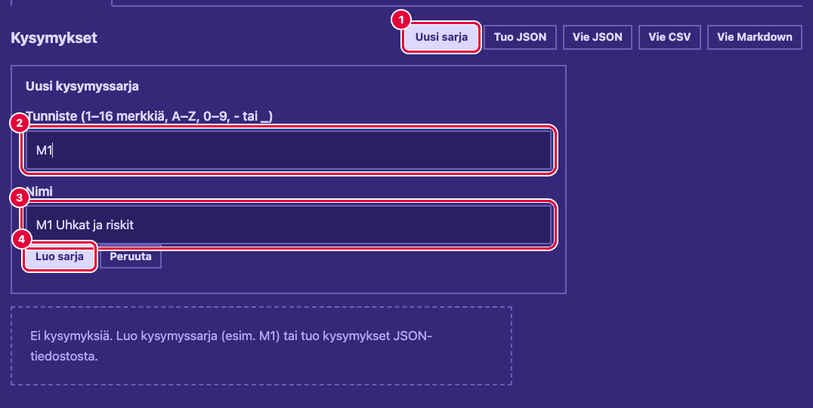

1. **Uusi sarja** avaa lomakkeen.
2. **Tunniste**: lyhyt koodi, esim. `M1` (1–16 merkkiä: A–Z, 0–9, - tai _).
3. **Nimi**: sarjan otsikko.
4. **Luo sarja**.

### 3.3 Uusi kysymys

Paina sarjan rivillä **Uusi kysymys**.

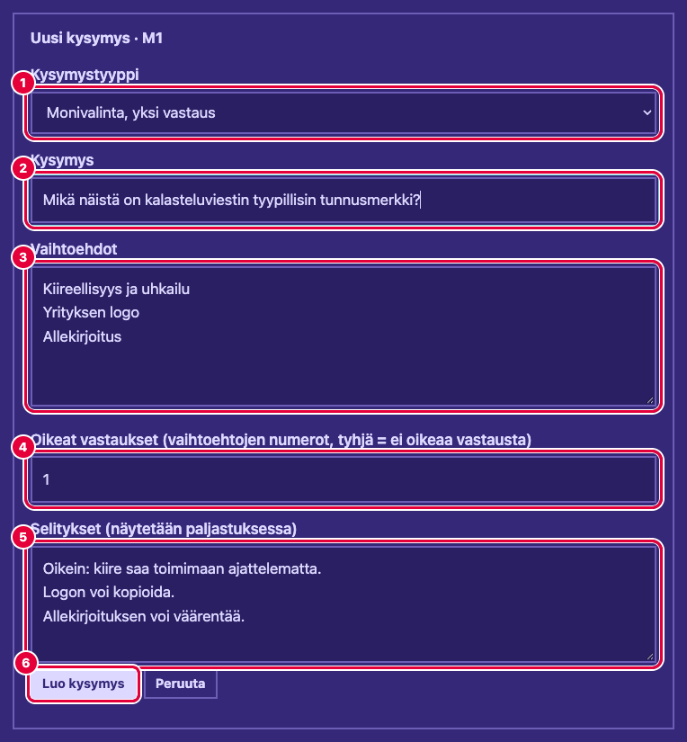

1. **Kysymystyyppi** (ks. taulukko alla).
2. **Kysymys**: enintään 300 merkkiä.
3. **Vaihtoehdot**: yksi vaihtoehto riville, 2–10 kpl.
4. **Oikeat vastaukset**: vaihtoehtojen numerot, esim. `1` tai `1, 3`. Jätä tyhjäksi, jos oikeaa vastausta ei ole.
5. **Selitykset**: valinnainen selitys jokaiselle vaihtoehdolle omalle rivilleen. Näytetään, kun paljastat oikean vastauksen.
6. **Luo kysymys**. Uusi kysymys on **luonnos**: osallistujat eivät näe sitä ennen kuin avaat sen.

Oikeat vastaukset ja selitykset eivät lähde osallistujille ennen paljastusta.

| Kysymystyyppi | Osallistuja vastaa | Tulokset |
|---|---|---|
| Monivalinta, yksi vastaus | valitsee yhden | pylväät ja prosentit |
| Monivalinta, useita vastauksia | valitsee yhden tai useamman | pylväät ja prosentit |
| Sanapilvi | 1–3 sanaa | sanapilvi, yleisin isoimpana |
| Likert-asteikko | 5 tai 7 kohtaa | jakauma, keskiarvo ja mediaani |
| Asteikko 0–10 | luku 0–10 | jakauma, keskiarvo ja mediaani |
| Avoin teksti | vapaa teksti | lista, uusin ensin |

Avoimella tekstillä on omat asetuksensa:

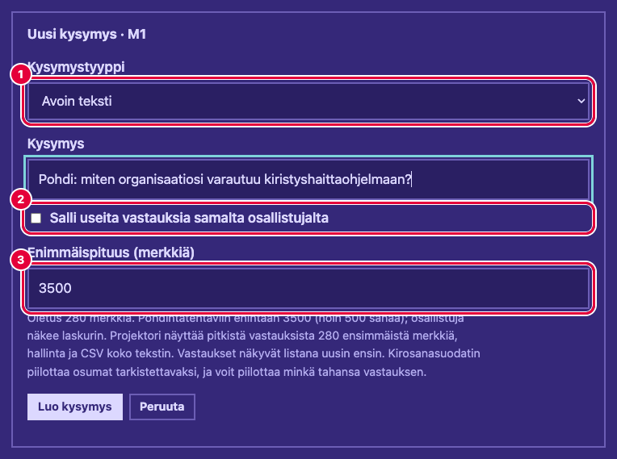

1. **Kysymystyyppi**: *Avoin teksti*.
2. **Salli useita vastauksia**: osallistuja voi lähettää useamman vastauksen. Muuten uusi vastaus korvaa edellisen.
3. **Enimmäispituus**: oletus 280 merkkiä. Pohdintatehtäviin enintään 3 500 merkkiä (noin 500 sanaa).

### 3.4 Sarjan ja kysymyksen painikkeet

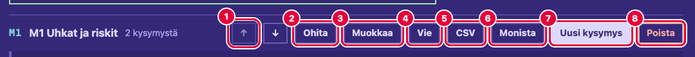

1. **↑ ↓**: siirrä sarjaa ylös tai alas.
2. **Ohita**: jättää sarjan pois *Seuraava*/*Edellinen*-järjestyksestä luennon aikana. Vastaukset säilyvät. *Palauta* tuo sarjan takaisin.
3. **Muokkaa**: tunniste ja nimi.
4. **Vie**: sarja JSON-tiedostoon.
5. **CSV**: sarjan tulokset taulukkona.
6. **Monista**: kopio sarjasta kysymyksineen ilman vastauksia.
7. **Uusi kysymys**.
8. **Poista**: sarja, sen kysymykset ja vastaukset pysyvästi.

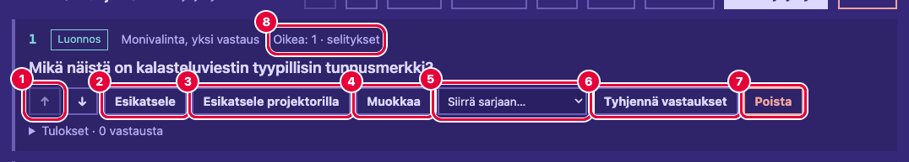

1. **↑ ↓**: siirrä kysymystä sarjan sisällä.
2. **Esikatsele**: kysymys osallistujan ulkoasussa (puhelimen kokoinen ikkuna). Vastausta ei lähetetä.
3. **Esikatsele projektorilla**: kysymys esitysnäkymässä omassa ikkunassaan.
4. **Muokkaa**: kysymysteksti, vaihtoehdot ja oikeat vastaukset. Tyyppiä ei voi vaihtaa.
5. **Siirrä sarjaan…**: siirtää kysymyksen toiseen sarjaan vastauksineen.
6. **Tyhjennä vastaukset**: poistaa kysymyksen vastaukset varmistuksen jälkeen. Vain Valmistelu-tilassa.
7. **Poista**: kysymys ja sen vastaukset pysyvästi.
8. Oikeat vastaukset näkyvät vain sinulle (*Oikea: 1 · selitykset*).

Julkaistulla kysymyksellä on lisäksi **Palauta luonnokseksi**: kysymys poistuu näytöltä ja osallistujilta, ja tulokset
ja oikea vastaus piilotetaan. Annetut vastaukset säilyvät.

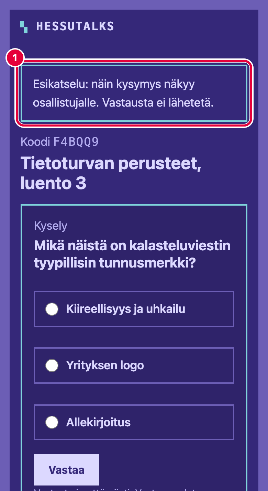

1. Esikatselussa yläreunassa on huomautus, ettei vastausta lähetetä.

### 3.5 Tuonti ja vienti

Kysymykset voi kirjoittaa tiedostoon ja tuoda kerralla. Tiedostomuodon kuvaus on erillisessä ohjeessa
[Kysymysten tuontitiedosto](tuontimuoto.md). Kun annat tekoälylle oppimateriaalin ja tuo kuvauksen, se voi tuottaa
tuontitiedoston suoraan materiaalista.

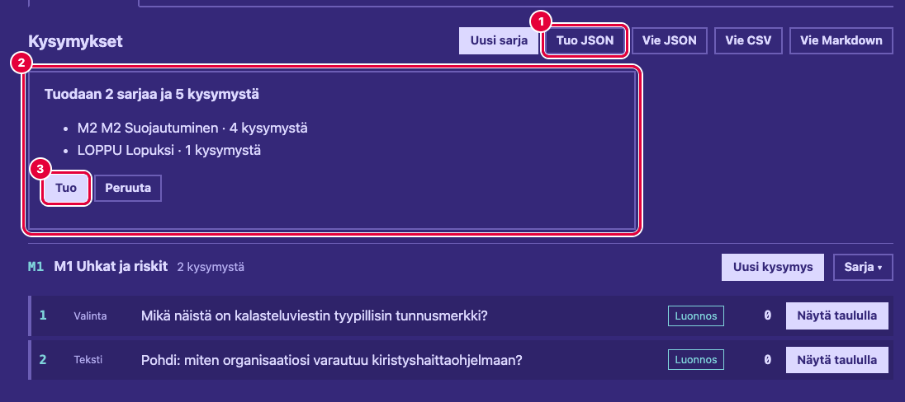

1. **Tuo JSON**: valitse tiedosto.
2. Yhteenveto näyttää tuotavat sarjat ja kysymykset sekä mahdolliset virheet. Mitään ei vielä tallenneta.
3. **Tuo**: tallentaa sarjat. Jos tiedostossa on virhe, mitään ei tuoda.

Raportit:

- **Vie CSV**: kysymys, vaihtoehto tai teksti, vastausmäärä ja aikaleima. Ei osallistujatunnisteita.
- **Vie Markdown**: koko luennon raportti: tulokset taulukkoina, oikeat vastaukset, avoimet vastaukset sekä osallistujien
  kysymykset ja palaute. Ei nimimerkkejä.

Vastaukset puretaan raporttia varten omassa selaimessasi. Palvelin ei näe raporttien sisältöä.

## 4. Osallistujan näkymä

### 4.1 Liittyminen

Osallistuja skannaa QR-koodin tai avaa etusivun ja kirjoittaa koodin.

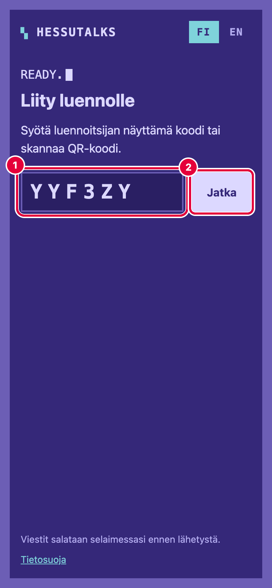

1. **Koodi**: luennon kuusimerkkinen koodi.
2. **Jatka**.

### 4.2 Luennon sivu

1. **Luennon kysymykset**: luennoitsijan avaamat kysymykset tulevat tähän itsestään noin sekunnissa.
2. **Nimimerkki**: pakollinen ja luennolla uniikki. Nimimerkki on vain viestejä varten. Kyselyihin vastataan ilman sitä.
3. **Kysy tai anna palautetta**.
4. **FI / EN**: kielen vaihto.

### 4.3 Kysymys tai palaute

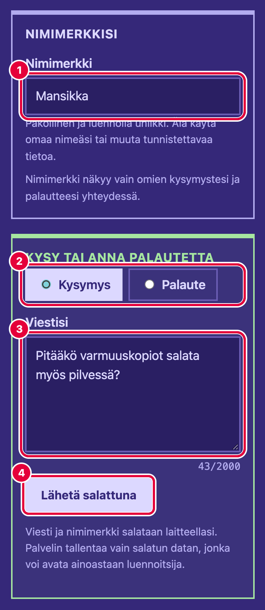

1. **Nimimerkki**: esim. *Mansikka*. Älä käytä omaa nimeä.
2. **Kysymys** tai **Palaute**.
3. **Viestisi**: enintään 2 000 merkkiä.
4. **Lähetä salattuna**: viesti ja nimimerkki salataan laitteessa ennen lähetystä.

1. Nimimerkki on nyt varattu tälle selaimelle. Seuraavalla luennolla se ehdotetaan valmiiksi.
2. Kuittaus lähetetystä viestistä.

### 4.4 Kyselyyn vastaaminen

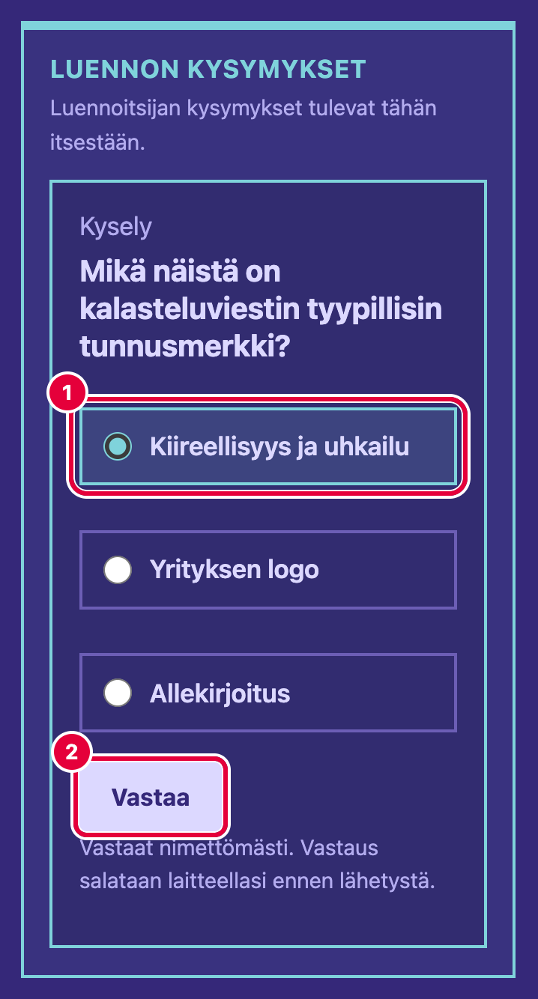

1. Valitse vaihtoehto.
2. **Vastaa**. Vastauksen voi muuttaa, kunnes kysely suljetaan.

Kun näytät tulokset ja paljastat oikean vastauksen, osallistuja näkee ne omassa puhelimessaan:

Jos näytöllä on useita kysymyksiä, ne ovat allekkain, ja osallistuja voi vastata kaikkiin avoimiin:

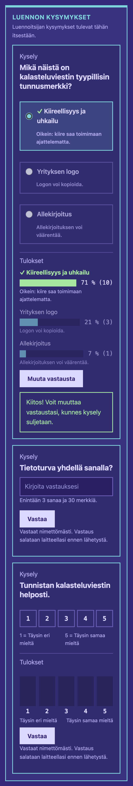

## 5. Luennolla: kysymykset näytölle

### 5.1 Esitysnäyttö

Esitysnäyttö on oma ikkunansa projektorille tai Teams-jakoon. Kytke projektori jatketuksi näytöksi (ei peilaus),
jolloin hallinta jää läppärin näytölle.

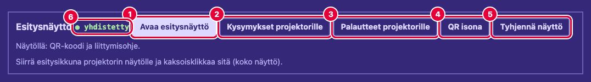

1. **Avaa esitysnäyttö**: avaa ikkunan. Chrome ja Edge siirtävät sen toiselle näytölle (selain kysyy kerran luvan).
   Muissa selaimissa raahaa ikkuna projektorille. Kaksoisklikkaus tai **F** vaihtaa koko näytön tilaan.
2. **Kysymykset projektorille**: osallistujien kysymykset listana näytölle.
3. **Palautteet projektorille**: palautteet listana näytölle.
4. **QR isona**: iso QR-koodi koko näytölle (myös **Q**).
5. **Tyhjennä näyttö**: kaikki pois näytöltä. Vastaukset säilyvät.
6. Tila kertoo, onko esitysnäyttö yhdistetty.

Kun näytöllä ei ole mitään, siinä on QR-koodi ja liittymisohje:

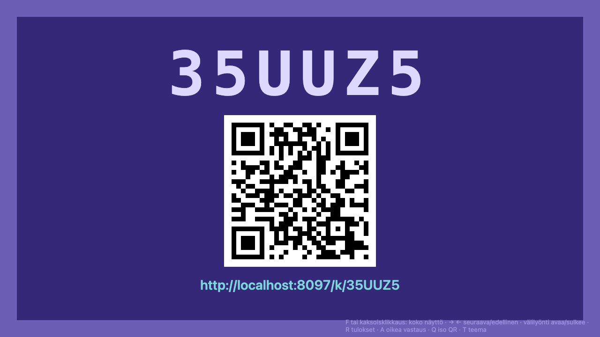

### 5.2 Luennolla-tila

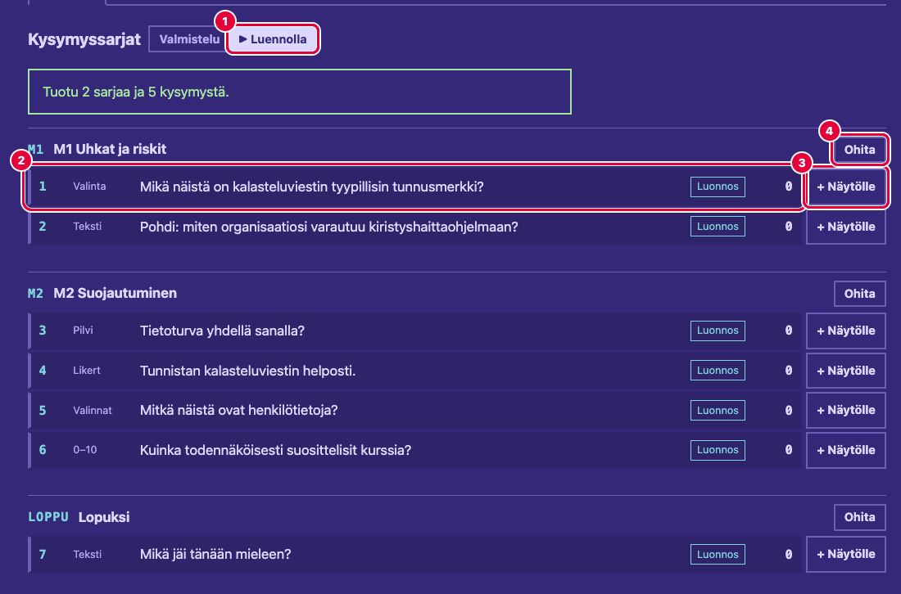

1. **▶ Luennolla**: tiivis lista kaikista kysymyksistä. Muokkaus- ja poistonapit ovat piilossa, joten mitään ei poisteta vahingossa.
2. **Rivin klikkaus**: tuo kysymyksen näytölle ja tekee siitä aktiivisen.
3. **+ Näytölle**: lisää kysymyksen näytölle muiden rinnalle. *✓ Näytöllä* poistaa sen.
4. **Ohita**: jättää sarjan pois *Seuraava*/*Edellinen*-järjestyksestä.

### 5.3 Ohjauspalkki

Ohjauspalkki ohjaa **aktiivista kysymystä**, eli viimeksi näytölle tuotua.

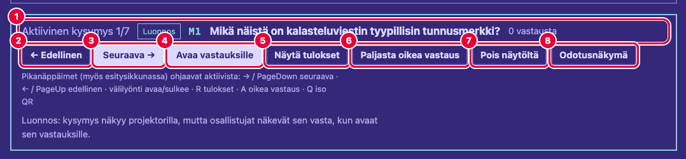

1. Aktiivinen kysymys, sen tila (*Luonnos*, *Auki* tai *Suljettu*), sarja ja vastausmäärä.
2. **← Edellinen**: vaihtaa aktiivisen kysymyksen edelliseen.
3. **Seuraava →**: vaihtaa aktiivisen kysymyksen seuraavaan. Muut näytöllä olevat pysyvät.
4. **Avaa vastauksille**: osallistujat näkevät kysymyksen ja voivat vastata. Luonnos näkyy projektorilla, mutta ei osallistujille ennen avaamista.
5. **Näytä tulokset**: tulokset projektorille ja osallistujien puhelimiin. Tulokset ovat aluksi piilossa.
6. **Paljasta oikea vastaus**: korostaa oikeat vaihtoehdot ja näyttää selitykset. Nappi näkyy vain, jos kysymyksellä on oikea vastaus.
7. **Pois näytöltä**: kysymys pois projektorilta ja osallistujilta. Vastaukset säilyvät.
8. **Odotusnäkymä**: kaikki kysymykset pois näytöltä.

Kun kysymys on auki, napit vaihtuvat:

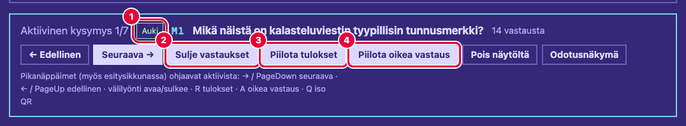

1. Tila **Auki**.
2. **Sulje vastaukset**: uusia vastauksia ei enää oteta vastaan.
3. **Piilota tulokset**.
4. **Piilota oikea vastaus**.

### 5.4 Projektorilla

Avoin kysymys projektorilla. Tulokset ovat piilossa, kunnes näytät ne:

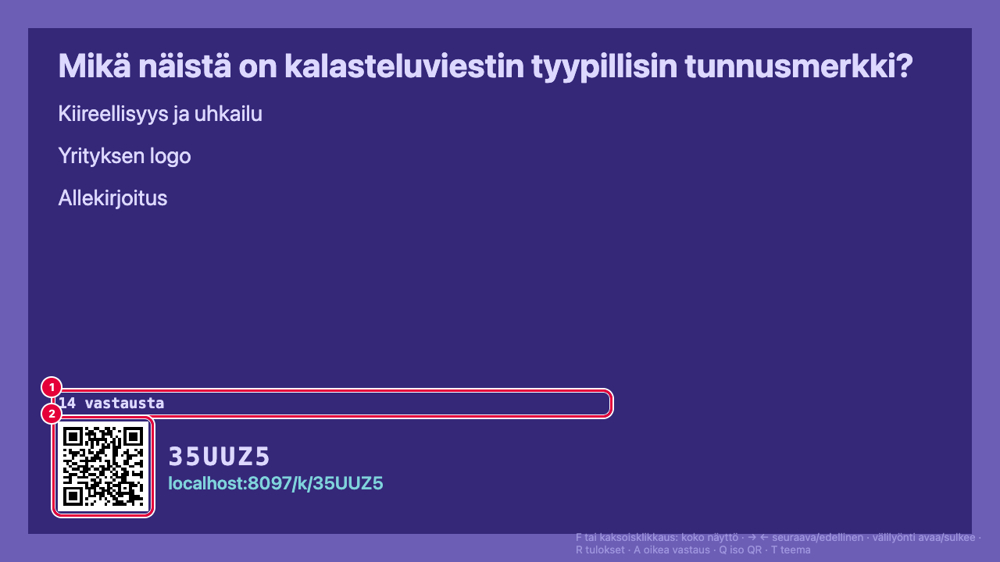

1. Vastausmäärä päivittyy noin sekunnissa.
2. QR-koodi ja liittymiskoodi ovat aina alareunassa myöhässä tulijoita varten.

Tulokset ja paljastettu oikea vastaus:

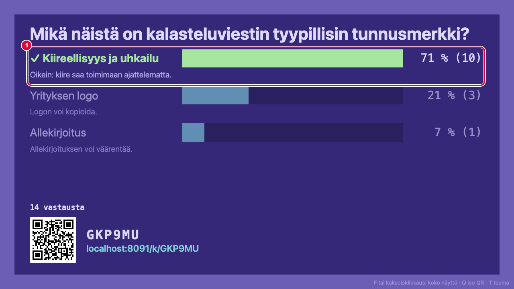

1. Oikea vaihtoehto on korostettu, ja selitykset näkyvät vaihtoehtojen alla.

### 5.5 Useita kysymyksiä näytöllä

Voit pitää näytöllä useita kysymyksiä yhtä aikaa, esimerkiksi aloituskyselyn ja sanapilven. Lisää ne listasta
**+ Näytölle** -napilla.

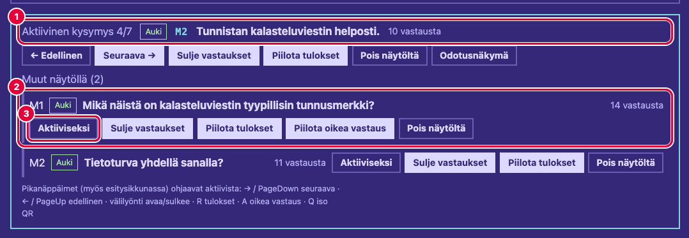

1. Aktiivinen kysymys: pikanäppäimet ja puhelinohjain ohjaavat sitä.
2. **Muut näytöllä**: jokaisella on omat napit (avaa, sulje, tulokset, paljastus, pois näytöltä).
3. **Aktiiviseksi**: tekee kysymyksestä aktiivisen.

Projektori näyttää kysymykset ruudukkona (enintään 12), ja tekstikoko sovitetaan ruudun kokoon:

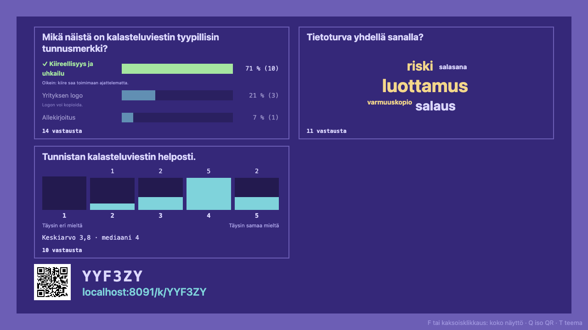

## 6. Tulokset ja moderointi

Tulokset lasketaan sinun selaimessasi, koska vastaukset ovat salattuja. Pidä hallinta auki luennon ajan.

Valmistelu-tilassa kunkin kysymyksen tulokset ovat kortin kohdassa *Tulokset*.

### 6.1 Sanapilvi

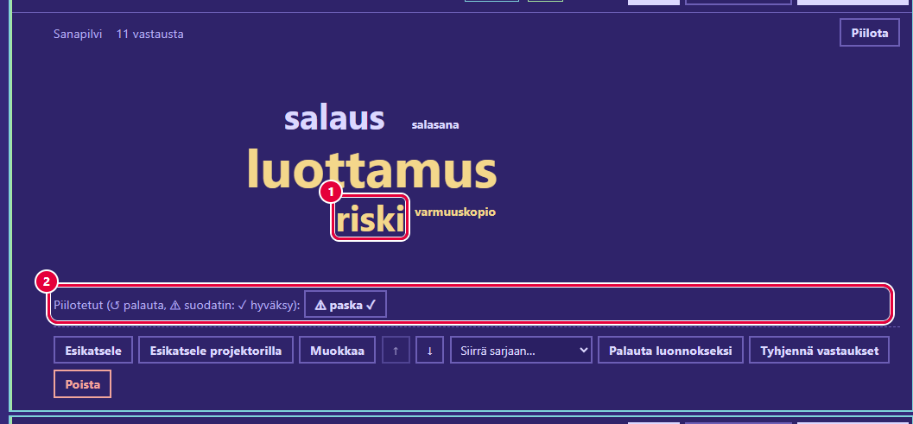

1. **Klikkaa sanaa**: sana piilotetaan, ja se katoaa projektorilta heti.
2. **Piilotetut**: ↺ palauttaa sanan. Kirosanasuodatin (suomi ja englanti) piilottaa osumat automaattisesti
   merkinnällä ⚠. Hyväksy ne ✓-merkillä, jos ne ovat asiallisia.

### 6.2 Avoimet vastaukset

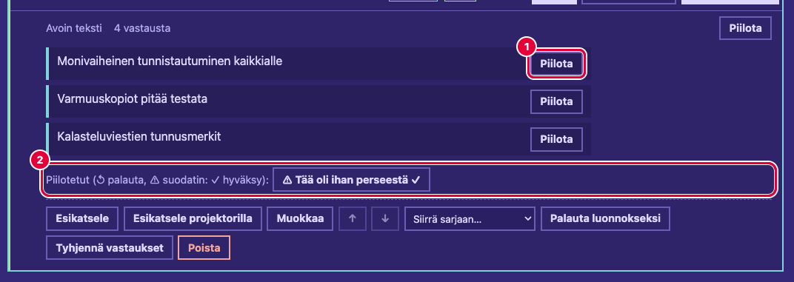

1. **Piilota**: vastaus katoaa projektorilta heti.
2. **Piilotetut**: piilotetut ja suodattimen pysäyttämät vastaukset. Palauta tai hyväksy ne tarvittaessa.

Piilotukset tallennetaan palvelimelle salattuina, joten ne säilyvät, vaikka lataat sivun uudelleen.

## 7. Osallistujien kysymykset ja palaute

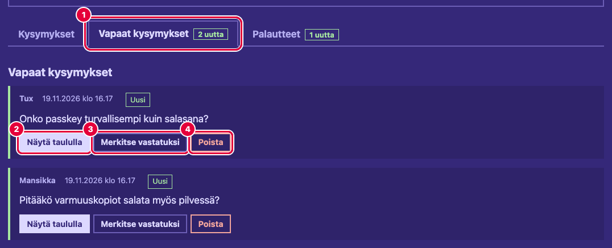

1. **Kysymykset ja palaute** -välilehti. Merkki kertoo uusien viestien määrän.
2. **Suodattimet**: *Käsiteltävät* (uudet ja vastatut), *Uudet*, *Vastatut*, *Arkisto* ja *Kaikki*.
3. **Näytä projektorilla**: viesti isona näytölle muun sisällön rinnalle. Viesti merkitään samalla vastatuksi.
4. **Merkitse vastatuksi**. *Palauta uudeksi* peruu merkinnän.
5. **Arkistoi**: piilottaa viestin listalta. Arkistoidut eivät näy projektorin listoilla eivätkä raporteissa.
6. **Poista**: viesti pysyvästi.

Viesti ja palautelista projektorilla:

## 8. Puhelinohjain

Puhelinohjaimella ohjaat aktiivista kysymystä kävellessäsi salissa. Kirjaudu hallintaan puhelimella. Ohjain ei
pura viestejä, joten salausavainta ei tarvita.

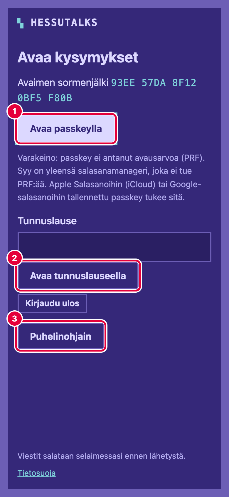

1. **Avaa passkeylla**: avaa viestit (ei tarvita ohjaimeen).
2. **Puhelinohjain**: valitse luento ja paina *Ohjaa*.
3. **Avaa tunnuslauseella**: varakeino, jos passkey ei pysty avaamaan avainta.

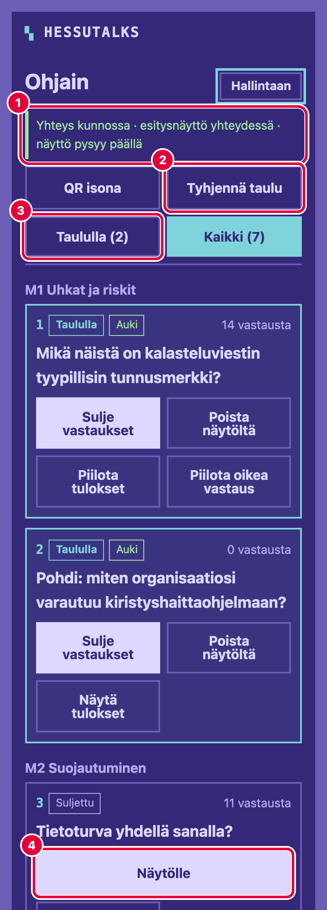

1. Aktiivinen kysymys, tila ja vastausmäärä. Isot napit vastaavat ohjauspalkin nappeja.

Projektoria ohjaava läppäri huomaa ohjaimen muutokset parissa sekunnissa. Ohjaimen saa myös luennon sivun napista **Ohjain**.

## 9. Asetukset ja kirjautuminen

1. **Uuden passkeyn nimi**: esim. *iPhone*.
2. **Lisää passkey**: lisää varapasskey toiseen laitteeseen, ettet lukitse itseäsi ulos.
3. **Lataa avaimen varmuuskopio**.
4. **Vaihda tunnuslause**: kirjoita uusi tunnuslause kahdesti. Uusi varmuuskopio ladataan.
5. **Tietoturvaloki**: kirjautumiset ja hallinnan muutokset.

Kirjautuminen:

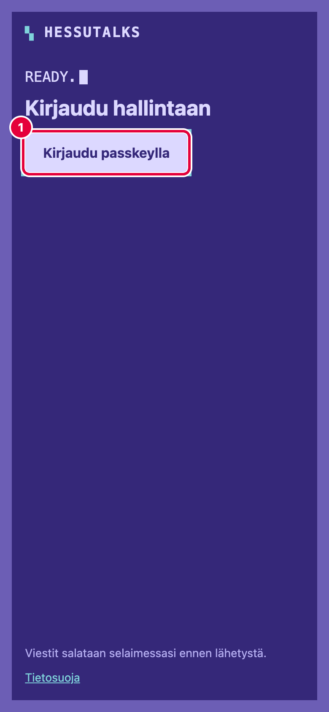

1. **Kirjaudu passkeylla**. Jos passkey tukee avausta (PRF), viestit avautuvat samalla. Muuten kirjoita tunnuslause kerran,
   jonka jälkeen passkey riittää jatkossa.

Istunto päättyy 3 tunnin toimettomuuden jälkeen ja viimeistään 8 tunnin kuluttua. Esitysnäyttö tyhjenee, kun kirjaudut ulos
tai suljet hallinnan.

## 10. Pikanäppäimet

Pikanäppäimet toimivat hallinnassa ja esitysikkunassa (eivät lomakekentissä). Ne ohjaavat aktiivista kysymystä.

| Näppäin | Toiminto |
|---|---|
| → / PageDown | Seuraava kysymys (myös langaton esitysohjain) |
| ← / PageUp | Edellinen kysymys |
| Välilyönti | Avaa tai sulje vastaukset |
| R | Näytä tai piilota tulokset |
| A | Paljasta oikea vastaus |
| Q | Iso QR-koodi |
| T | Vaalea tai tumma teema (esitysikkuna) |
| F tai kaksoisklikkaus | Koko näyttö (esitysikkuna) |

---

Kuvat on tuotettu testidatalla komennolla `scripts/e2e.sh "docs-screenshots.mjs fi" "docs-screenshots.mjs en"`.
Aja se uudelleen, kun käyttöliittymä muuttuu.
