# HessuTalks-käyttöohje

**Suomi** · [English](user-guide.md)

HessuTalks on luennon kysymys-, palaute- ja kyselykanava. Osallistujat liittyvät puhelimella koodilla tai QR-koodilla,
kysyvät nimimerkillä ja vastaavat kyselyihin. Kaikki viestit ja vastaukset salataan osallistujan laitteessa, ja vain
luennoitsija voi lukea ne.

Ohjeen kuvissa punainen kehys osoittaa kuvatun painikkeen tai alueen. Kehyksen numero viittaa kuvan alla olevaan listaan.

**Sisältö**

1. [Käyttöönotto](#1-käyttöönotto)
2. [Luennon luominen](#2-luennon-luominen)
3. [Kysymysten valmistelu](#3-kysymysten-valmistelu)
4. [Osallistujan näkymä](#4-osallistujan-näkymä)
5. [Luennolla: kysymykset taululle](#5-luennolla-kysymykset-taululle)
6. [Tulokset ja moderointi](#6-tulokset-ja-moderointi)
7. [Vapaat kysymykset ja palautteet](#7-vapaat-kysymykset-ja-palautteet)
8. [Asetukset ja kirjautuminen](#8-asetukset-ja-kirjautuminen)
9. [Pikanäppäimet](#9-pikanäppäimet)

Hallinta on aina suomeksi. Osallistujan sivut ja projektorin tekstit ovat suomeksi tai englanniksi luennon kielen mukaan.

## 1. Käyttöönotto

Käyttöönotto tehdään kerran. Tarvitset käyttöönottotunnuksen, joka tulostuu, kun ylläpitäjä luo asetustiedoston,
ja laitteen, joka tukee passkeyta (esim. Touch ID, Face ID, Windows Hello tai turva-avain).

### 1.1 Ota hallinta käyttöön

Avaa hallintanäkymä. Osoitteen saat ylläpitäjältä.

1. **Käyttöönottotunnus**: liitä tunnus tähän.
2. **Passkeyn nimi**: laitteen nimi, josta tunnistat passkeyn myöhemmin (esim. *MacBook Pro*).
3. **Luo passkey**: selain pyytää vahvistamaan sormenjäljellä, kasvoilla tai PIN-koodilla. Salasanaa ei ole.

### 1.2 Luo salausavaimet

Viestit salataan julkisella avaimella. Ne voi avata vain yksityisellä avaimella, joka suojataan tunnuslauseella.

1. **Uusi tunnuslause**: vähintään 12 merkkiä. Tallenna se salasanojen hallintaan.
2. **Toista tunnuslause**.
3. **Luo avaimet**: selain lataa avaimen varmuuskopion. Säilytä se turvassa.

> **Tärkeää:** jos tunnuslause ja varmuuskopio katoavat, viestejä ei voi avata kukaan. Palvelin ei koskaan näe tunnuslausetta.

## 2. Luennon luominen

### 2.1 Uusi luento

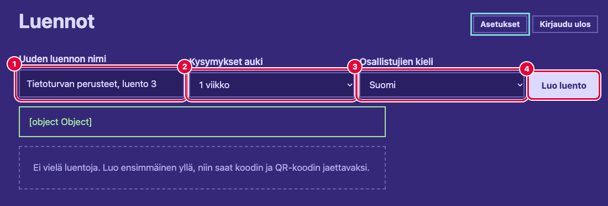

1. **Uuden luennon nimi**: näkyy osallistujille.
2. **Kysymykset auki**: kuinka kauan osallistujat voivat lähettää viestejä (3 tuntia, vuorokausi, viikko tai kunnes suljet).
3. **Osallistujien kieli**: *English*, *Suomi* tai selaimen kielen mukaan. Osallistuja voi silti vaihtaa kieltä.
4. **Luo luento**: avaa luennon sivun.

Yksi luento voi kattaa koko kurssin: osallistujat käyttävät samaa koodia ja nimimerkkiä kaikilla kerroilla.

### 2.2 Luennon sivu: koodi ja QR-koodi

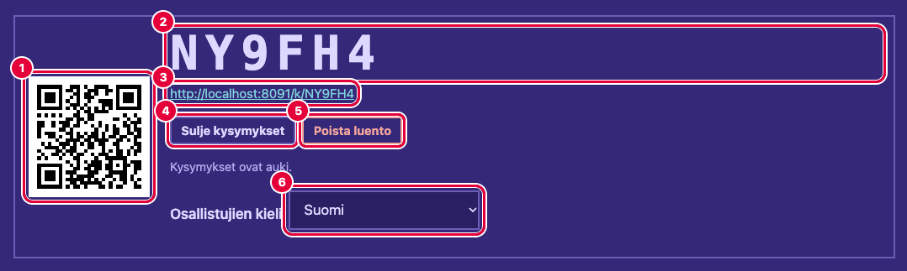

1. **QR-koodi**: näytä se diassa tai projektorilla. Osallistujat liittyvät skannaamalla sen.
2. **Liittymiskoodi**: kuusi merkkiä, jotka voi kirjoittaa etusivulle.
3. **Linkki** osallistujan sivulle. Avaa se, jos haluat nähdä osallistujan näkymän.
4. **Sulje kysymykset**: osallistujat eivät voi enää lähettää viestejä. Saman napin nimi on suljetulla luennolla *Avaa kysymykset*.
5. **Poista luento**: poistaa luennon ja kaikki sen viestit pysyvästi.
6. **Arkistoi**: sulkee kysymykset, tyhjentää taulun ja siirtää luennon arkistoon ilman tietojen poistoa. Sulkeutumisaika arkistoituu automaattisesti. Arkistossa luento voidaan palauttaa suljettuna, avata tai poistaa pysyvästi.
7. **Osallistujien kieli**: voit vaihtaa kielen myöhemmin. Myös projektorin tekstit vaihtuvat.

### 2.3 Työkalupalkki

1. **Muokkaa otsikkoa**: korjaa luennon nimen. Koodi ja QR-koodi pysyvät samoina, joten diojen linkit toimivat edelleen.
2. **Kaikki luennot**: luentolista.
3. **Asetukset**: passkeyt, salausavain ja tietoturvaloki (ks. [luku 8](#8-asetukset-ja-kirjautuminen)).
4. **Kirjaudu ulos**.

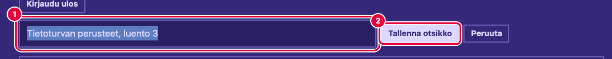

1. Kirjoita uusi otsikko.
2. **Tallenna otsikko**.

### 2.4 Luentolista

1. Luennon rivillä näkyvät koodi, nimi, uusien viestien määrä, luontiaika ja viestien määrä.
2. **Avaa**: luennon sivu.
3. **Ohjain**: puhelinohjain (ks. [luku 5.5](#55-puhelinohjain)).

## 3. Kysymysten valmistelu

Ennalta laaditut kysymykset ovat **Kysymykset**-välilehdellä **kysymyssarjoissa**, esimerkiksi yksi sarja moduulia tai
luentokertaa kohden. Valmistele sarjat ennen luentoa. Samasta listasta näytät kysymykset luennolla (ks. [luku 5](#5-luennolla-kysymykset-taululle)).

### 3.1 Kysymykset-välilehden työkalut

1. **Uusi sarja**.
2. **Tuo JSON**: sarjat tiedostosta (ks. [3.5](#35-tuonti-ja-vienti)).
3. **Vie JSON**: kaikki sarjat tiedostoon, esimerkiksi seuraavaa toteutusta varten.
4. **Vie CSV**: tulokset taulukkona (Excel avaa suoraan).
5. **Vie Markdown**: raportti luennosta: kysymykset, tulokset ja osallistujien viestit.

### 3.2 Uusi kysymyssarja

1. **Uusi sarja** avaa lomakkeen.
2. **Tunniste**: lyhyt koodi, esim. `M1` (1–16 merkkiä: A–Z, 0–9, - tai _).
3. **Nimi**: sarjan otsikko.
4. **Luo sarja**.

### 3.3 Uusi kysymys

Paina sarjan rivillä **Uusi kysymys**.

1. **Kysymystyyppi** (ks. taulukko alla).
2. **Kysymys**: enintään 300 merkkiä.
3. **Vaihtoehdot**: yksi vaihtoehto riville, 2–10 kpl.
4. **Oikeat vastaukset**: vaihtoehtojen numerot, esim. `1` tai `1, 3`. Jätä tyhjäksi, jos oikeaa vastausta ei ole.
5. **Selitykset**: valinnainen selitys jokaiselle vaihtoehdolle omalle rivilleen. Näytetään, kun paljastat oikean vastauksen.
6. **Luo kysymys**. Uusi kysymys on **luonnos**: osallistujat eivät näe sitä ennen kuin näytät sen taululla.

Oikeat vastaukset ja selitykset eivät lähde osallistujille ennen paljastusta.

| Kysymystyyppi | Osallistuja vastaa | Tulokset |
|---|---|---|
| Monivalinta, yksi vastaus | valitsee yhden | pylväät ja prosentit |
| Monivalinta, useita vastauksia | valitsee yhden tai useamman | pylväät ja prosentit |
| Sanapilvi | 1–3 sanaa | sanapilvi, yleisin isoimpana |
| Likert-asteikko | 5 tai 7 kohtaa | jakauma, keskiarvo ja mediaani |
| Asteikko 0–10 | luku 0–10 | jakauma, keskiarvo ja mediaani |
| Avoin teksti | vapaa teksti | lista, uusin ensin |

Avoimella tekstillä on omat asetuksensa:

1. **Kysymystyyppi**: *Avoin teksti*.
2. **Salli useita vastauksia**: osallistuja voi lähettää useamman vastauksen. Muuten uusi vastaus korvaa edellisen.
3. **Enimmäispituus**: oletus 280 merkkiä. Pohdintatehtäviin enintään 3 500 merkkiä (noin 500 sanaa).

### 3.4 Sarjan ja kysymyksen painikkeet

1. **Uusi kysymys**.
2. **Sarja ▾**: näyttää tai piilottaa sarjan työkalut.
3. **Muokkaa**: tunniste ja nimi.
4. **↑ ↓**: siirrä sarjaa ylös tai alas.
5. **Vie JSON**: sarja tiedostoon.
6. **Vie CSV**: sarjan tulokset taulukkona.
7. **Monista**: kopio sarjasta kysymyksineen ilman vastauksia.
8. **Poista sarja**: sarja, sen kysymykset ja vastaukset pysyvästi.

Kysymyksen muokkaus on kysymyksen alla. Klikkaa kysymyksen riviä, niin sen tulokset ja muokkausnapit avautuvat:

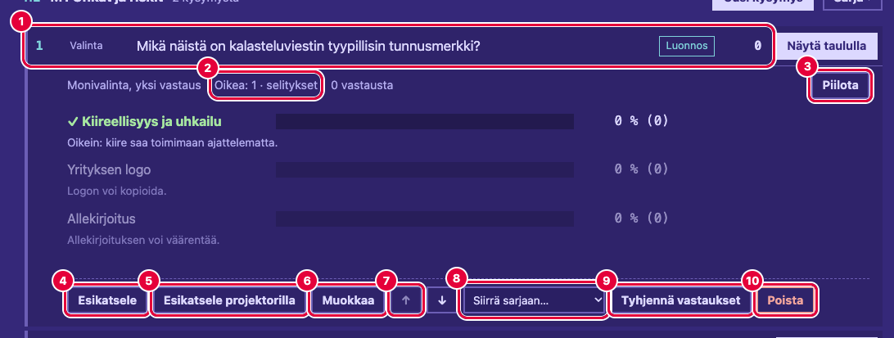

1. **Kysymyksen rivi**: klikkaus avaa ja sulkee alla olevan osan.
2. Oikeat vastaukset näkyvät vain sinulle (*Oikea: 1 · selitykset*).
3. **Piilota**: sulkee osan.
4. **Esikatsele**: kysymys osallistujan ulkoasussa (puhelimen kokoinen ikkuna). Vastausta ei lähetetä.
5. **Esikatsele projektorilla**: kysymys esitysnäkymässä omassa ikkunassaan.
6. **Muokkaa**: kysymysteksti, vaihtoehdot ja oikeat vastaukset. Tyyppiä ei voi vaihtaa.
7. **↑ ↓**: siirrä kysymystä sarjan sisällä.
8. **Siirrä sarjaan…**: siirtää kysymyksen toiseen sarjaan vastauksineen.
9. **Tyhjennä vastaukset**: poistaa kysymyksen vastaukset varmistuksen jälkeen.
10. **Poista**: kysymys ja sen vastaukset pysyvästi varmistuksen jälkeen.

Vastausten tyhjennys ja poisto ovat vain täällä, jotta luennon aikana annettuja vastauksia ei poisteta vahingossa.
Taululla käyneellä kysymyksellä on lisäksi **Palauta luonnokseksi**: kysymys poistuu taululta ja osallistujilta, ja
tulokset ja oikea vastaus piilotetaan. Annetut vastaukset säilyvät.

1. Esikatselussa yläreunassa on huomautus, ettei vastausta lähetetä.

### 3.5 Tuonti ja vienti

Kysymykset voi kirjoittaa tiedostoon ja tuoda kerralla. Tiedostomuodon kuvaus on erillisessä ohjeessa
[Kysymysten tuontitiedosto](tuontimuoto.md). Kun annat tekoälylle oppimateriaalin ja tuo kuvauksen, se voi tuottaa
tuontitiedoston suoraan materiaalista.

1. **Tuo JSON**: valitse tiedosto.
2. Yhteenveto näyttää tuotavat sarjat ja kysymykset sekä mahdolliset virheet. Mitään ei vielä tallenneta.
3. **Tuo**: tallentaa sarjat. Jos tiedostossa on virhe, mitään ei tuoda.

Raportit:

- **Vie CSV**: kysymys, vaihtoehto tai teksti, vastausmäärä ja aikaleima. Ei osallistujatunnisteita.
- **Vie Markdown**: koko luennon raportti: tulokset taulukkoina, oikeat vastaukset, avoimet vastaukset sekä osallistujien
  kysymykset ja palaute. Ei nimimerkkejä.

Vastaukset puretaan raporttia varten omassa selaimessasi. Palvelin ei näe raporttien sisältöä.

## 4. Osallistujan näkymä

### 4.1 Liittyminen

Osallistuja skannaa QR-koodin tai avaa etusivun ja kirjoittaa koodin.

1. **Koodi**: luennon kuusimerkkinen koodi.
2. **Jatka**.

### 4.2 Luennon sivu

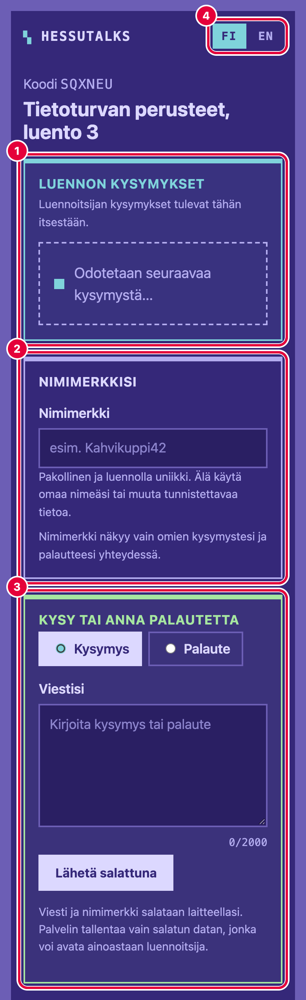

1. **Luennon kysymykset**: luennoitsijan avaamat kysymykset tulevat tähän itsestään noin sekunnissa.
2. **Nimimerkki**: pakollinen ja luennolla uniikki. Nimimerkki on vain viestejä varten. Kyselyihin vastataan ilman sitä.
3. **Kysy tai anna palautetta**.
4. **FI / EN**: kielen vaihto.

### 4.3 Kysymys tai palaute

1. **Nimimerkki**: esim. *Mansikka*. Älä käytä omaa nimeä.
2. **Kysymys** tai **Palaute**.
3. **Viestisi**: enintään 2 000 merkkiä.
4. **Lähetä salattuna**: viesti ja nimimerkki salataan laitteessa ennen lähetystä.

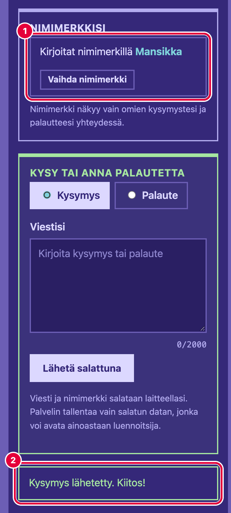

1. Nimimerkki on nyt varattu tälle selaimelle. Seuraavalla luennolla se ehdotetaan valmiiksi.
2. Kuittaus lähetetystä viestistä.

### 4.4 Kyselyyn vastaaminen

1. Valitse vaihtoehto.
2. **Vastaa**. Vastauksen voi muuttaa, kunnes kysely suljetaan.

Kun näytät tulokset ja paljastat oikean vastauksen, osallistuja näkee ne omassa puhelimessaan:

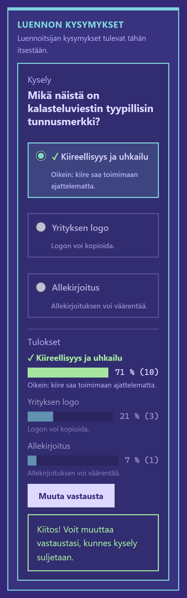

Jos taululla on useita kysymyksiä, ne ovat allekkain, ja osallistuja voi vastata kaikkiin avoimiin:

## 5. Luennolla: kysymykset taululle

Luennon aikana kaikki tehdään kahdessa paikassa: **taulurivillä** luennon sivun yläosassa ja **kysymyksen rivillä**
Kysymykset-välilehdellä. Erillisiä tiloja tai aktiivista kysymystä ei ole.

### 5.1 Taulu ja esitysnäyttö

Esitysnäyttö on oma ikkunansa projektorille tai Teams-jakoon. Kytke projektori jatketuksi näytöksi (ei peilaus),
jolloin hallinta jää läppärin näytölle.

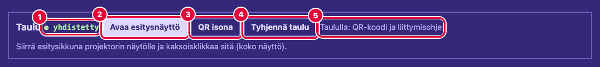

1. Tila kertoo, onko esitysnäyttö yhdistetty.
2. **Avaa esitysnäyttö**: avaa ikkunan. Chrome ja Edge siirtävät sen toiselle näytölle (selain kysyy kerran luvan).
   Muissa selaimissa raahaa ikkuna projektorille. Kaksoisklikkaus tai **F** vaihtaa koko näytön tilaan.
   Myös **Näytä taululla** avaa ikkunan, jos se ei ole auki.
3. **QR isona**: iso QR-koodi koko näytölle (myös **Q**). Se väistyy, kun tuot jotain taululle.
4. **Tyhjennä taulu**: kaikki pois taululta. Taululla olleet kysymykset suljetaan, ja vastaukset säilyvät.
5. **Puhelinohjain**: QR-koodi ohjaimen avaamiseen puhelimella (ks. [luku 5.5](#55-puhelinohjain)).
6. Mitä taululla on nyt.

Kun taululla ei ole mitään, siinä on QR-koodi ja liittymisohje:

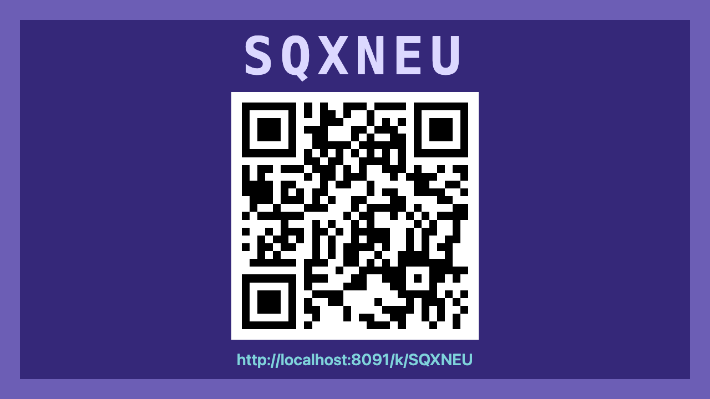

### 5.2 Kysymyksen rivi

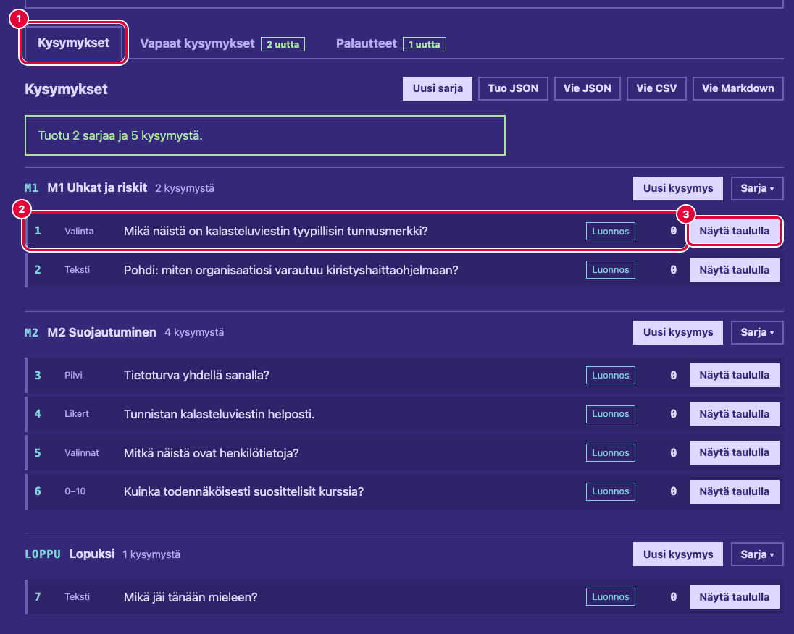

1. **Kysymykset**-välilehti: ennalta laaditut kysymykset sarjoittain ja numeroituina.
2. **Kysymyksen rivi**: klikkaus avaa tulokset ja muokkauksen rivin alle (ks. [luku 6](#6-tulokset-ja-moderointi)).
3. **Näytä taululla**: kysymys projektorille muiden rinnalle ja auki vastauksille yhdellä napilla.

Kun kysymys on taululla, rivin napit vaihtuvat:

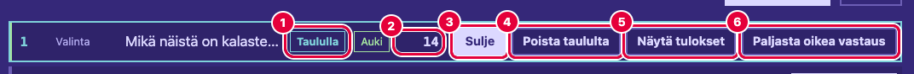

1. **Taululla** ja tila (*Auki* tai *Suljettu*).
2. Vastausmäärä.
3. **Sulje**: vastauksia ei enää oteta vastaan. Kysymys jää taululle, ja **Avaa vastauksille** avaa sen uudelleen.
4. **Poista taululta**: kysymys pois projektorilta ja osallistujien puhelimista. Vastaukset säilyvät, ja
   **Näytä taululla** avaa kysymyksen uudelleen.
5. **Näytä tulokset**: tulokset projektorille ja osallistujien puhelimiin. Tulokset ovat aluksi piilossa.
6. **Paljasta oikea vastaus**: korostaa oikeat vaihtoehdot ja näyttää selitykset. Nappi näkyy vain, jos kysymyksellä on oikea vastaus.

### 5.3 Projektorilla

Avoin kysymys projektorilla. Tulokset ovat piilossa, kunnes näytät ne:

1. Vastausmäärä päivittyy noin sekunnissa.
2. QR-koodi ja liittymiskoodi ovat aina alareunassa myöhässä tulijoita varten.

Tulokset ja paljastettu oikea vastaus:

1. Oikea vaihtoehto on korostettu, ja selitykset näkyvät vaihtoehtojen alla.

### 5.4 Useita kysymyksiä taululla

Voit pitää taululla useita kysymyksiä yhtä aikaa, esimerkiksi aloituskyselyn ja sanapilven. Paina **Näytä taululla**
kunkin kysymyksen riviltä. Jokaista ohjataan sen omista napeista.

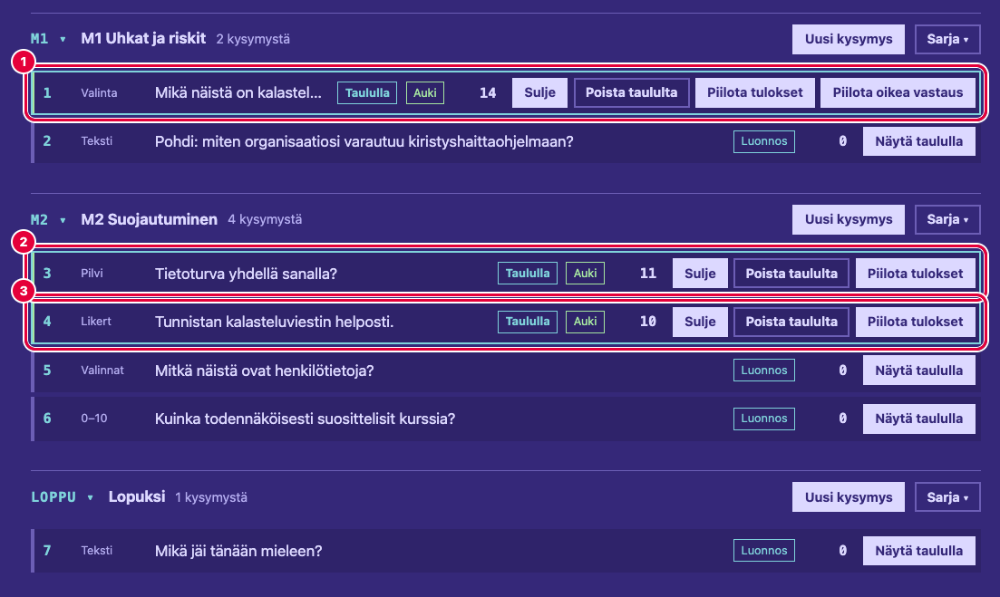

Kuvassa kolme kysymystä (1–3) on taululla ja auki. **Sulje** ja **Poista taululta** koskevat vain omaa kysymystään.

Projektori näyttää kysymykset ruudukkona (enintään 12), ja tekstikoko sovitetaan ruudun kokoon:

### 5.5 Puhelinohjain

Puhelinohjaimella ohjaat kysymyksiä puhelimesta kävellessäsi salissa. Läppärin hallinta pysyy auki ja päivittää
esitysnäytön. Ohjain ei pura viestejä eikä vastauksia, joten salausavainta ei avata puhelimessa.

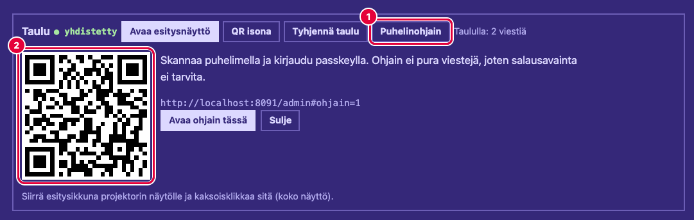

1. **Puhelinohjain** taulurivillä näyttää QR-koodin.
2. Skannaa se puhelimella ja kirjaudu passkeylla. Puhelimessa **Puhelinohjain** ja luentolistan **Ohjain** avaavat ohjaimen suoraan.

1. **Tila**: yhteys palvelimeen, onko läppärin esitysnäyttö yhteydessä ja pysyykö puhelimen näyttö päällä.
   Punainen teksti kertoo katkoksesta. Ohjain yrittää uudelleen itse ja päivittyy heti, kun näyttö tai verkko palaa.
2. **Tyhjennä taulu** (vahvistus) ja **QR isona**, kuten läppärillä. Tyhjennys poistaa myös läppäriltä nostetut viestit.
3. **Taululla** näyttää vain näytöllä olevat kysymykset, **Kaikki** kaikki sarjoittain.
4. **Näytölle**: kysymys projektorille muiden rinnalle ja auki vastauksille. Näytölle voi nostaa useita kysymyksiä.

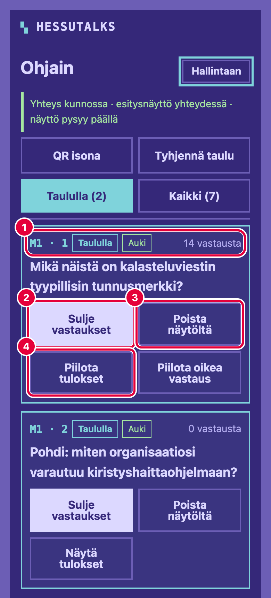

1. Tila yhdellä silmäyksellä: **Taululla**, *Auki* tai *Suljettu* ja vastausmäärä.
2. **Sulje vastaukset** tai **Avaa vastauksille**.
3. **Poista näytöltä**: pois projektorilta ja osallistujilta. Vastaukset säilyvät.
4. **Näytä tulokset** ja **Paljasta oikea vastaus** (jos kysymyksellä on oikea vastaus).

Vapaat kysymykset ja palautteet nostetaan taululle läppäriltä. Pidä puhelimen automaattinen lukitus riittävän
pitkänä, jos selain ei pysty pitämään näyttöä päällä.

## 6. Tulokset ja moderointi

Tulokset lasketaan sinun selaimessasi, koska vastaukset ovat salattuja. Pidä hallinta auki luennon ajan.
Klikkaa kysymyksen riviä, niin tulokset avautuvat sen alle:

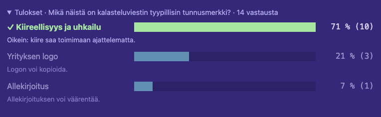

1. Tulokset. Hallinnassa luvut ja oikeat vastaukset näkyvät aina, myös kun ne ovat projektorilla piilossa.
2. **Piilota**: sulkee tulokset. Kysymys pysyy taululla.

### 6.1 Sanapilvi

1. **Klikkaa sanaa**: sana piilotetaan, ja se katoaa projektorilta heti.
2. **Piilotetut**: ↺ palauttaa sanan. Kirosanasuodatin (suomi ja englanti) piilottaa osumat automaattisesti
   merkinnällä ⚠. Hyväksy ne ✓-merkillä, jos ne ovat asiallisia.

### 6.2 Avoimet vastaukset

1. **Piilota**: vastaus katoaa projektorilta heti.
2. **Piilotetut**: piilotetut ja suodattimen pysäyttämät vastaukset. Palauta tai hyväksy ne tarvittaessa.

Piilotukset tallennetaan palvelimelle salattuina, joten ne säilyvät, vaikka lataat sivun uudelleen.

## 7. Vapaat kysymykset ja palautteet

Osallistujien vapaat kysymykset ja palautteet ovat omilla välilehdillään, uusin ensin.

1. **Vapaat kysymykset** -välilehti. Merkki kertoo uusien määrän. **Palautteet**-välilehti toimii samoin.
2. **Näytä taululla**: viesti isona projektorille muun sisällön rinnalle. **Poista taululta** vie sen pois.
   Taululla voi olla enintään 6 viestiä kerrallaan.
3. **Merkitse vastatuksi** (palautteella **Merkitse käsitellyksi**). **Palauta uudeksi** peruu merkinnän.
4. **Poista**: viesti pysyvästi.

Kysymys ja palaute projektorilla:

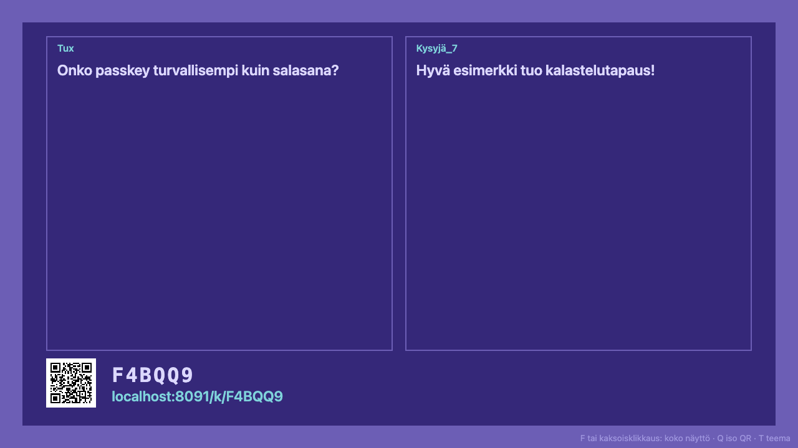

## 8. Asetukset ja kirjautuminen

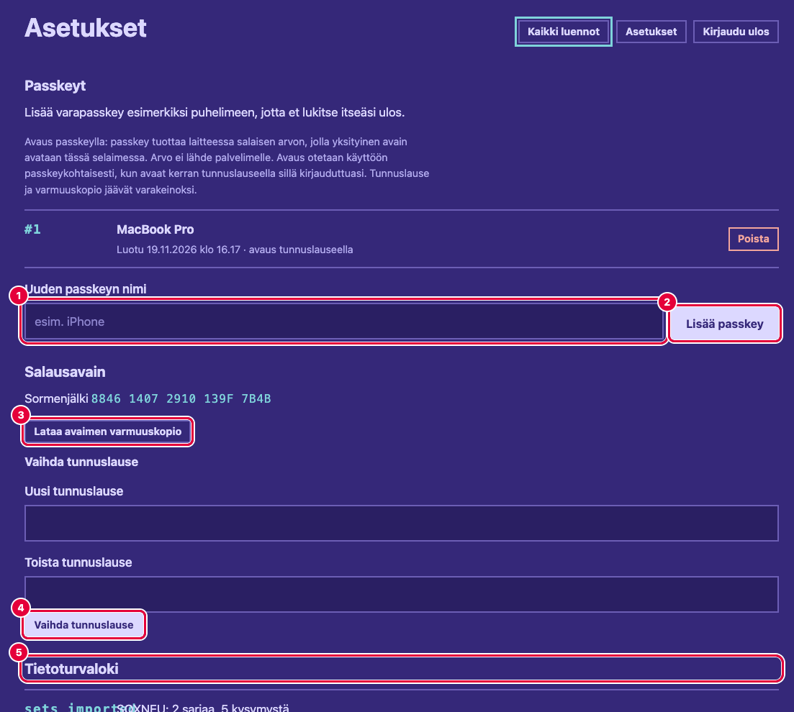

1. **Uuden passkeyn nimi**: esim. *iPhone*.
2. **Lisää passkey**: lisää varapasskey toiseen laitteeseen, ettet lukitse itseäsi ulos.
3. **Lataa avaimen varmuuskopio**.
4. **Vaihda tunnuslause**: kirjoita uusi tunnuslause kahdesti. Uusi varmuuskopio ladataan.
5. **Tietoturvaloki**: kirjautumiset ja hallinnan muutokset.

Kun avaat hallinnan uudessa ikkunassa tai toisella laitteella, viestit avataan ensin:

1. **Avaa passkeylla**: avaa viestit, jos passkey tukee avausta (PRF).
2. **Avaa tunnuslauseella**: varakeino, jos passkey ei pysty avaamaan avainta.
3. **Puhelinohjain**: kysymysten ohjaus avaamatta avainta (ks. [luku 5.5](#55-puhelinohjain)).

Kirjautuminen:

1. **Kirjaudu passkeylla**. Jos passkey tukee avausta (PRF), viestit avautuvat samalla. Muuten kirjoita tunnuslause kerran,
   jonka jälkeen passkey riittää jatkossa.

Istunto päättyy 3 tunnin toimettomuuden jälkeen ja viimeistään 8 tunnin kuluttua. Esitysnäyttö tyhjenee, kun kirjaudut ulos
tai suljet hallinnan.

## 9. Pikanäppäimet

Kysymyksiä ohjataan niiden riviltä. Pikanäppäimiä on kolme (eivät toimi lomakekentissä):

| Näppäin | Toiminto |
|---|---|
| Q | Iso QR-koodi (hallinnassa ja esitysikkunassa) |
| T | Vaalea tai tumma teema (esitysikkuna) |
| F tai kaksoisklikkaus | Koko näyttö (esitysikkuna) |

---

Kuvat on tuotettu testidatalla komennolla `scripts/e2e.sh "docs-screenshots.mjs fi" "docs-screenshots.mjs en"`.
Aja se uudelleen, kun käyttöliittymä muuttuu.
