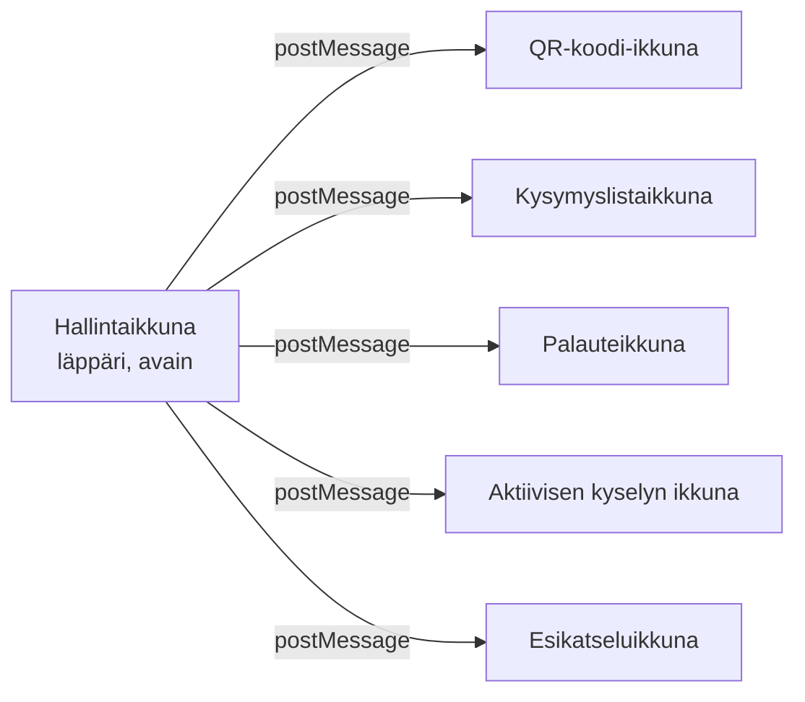
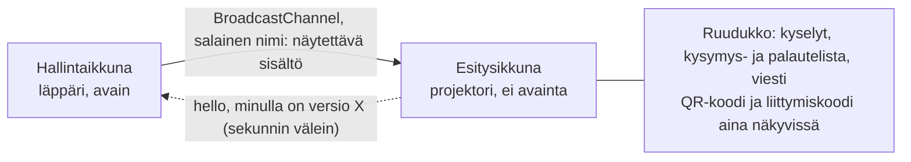

# Poikkeamakatselmus: esitysnäyttö

**Suomi** · [English](incident-presenter.md)

Ensimmäisessä oikeassa luentokäytössä luennoitsija ei saanut kysymyksiä, kyselyjen tuloksia eikä palautteita projektorille. Tämä katselmus kertoo, mikä meni vikaan, miksi automaattiset testit eivät huomanneet sitä, miten vika korjattiin samana iltana kahdessa vaiheessa ja miten korjaukset testattiin. Korjaukset: PR #40 ja #41.

## 1. Mitä käyttäjä näki

> "Käytettävyys on tosi huono. Kysymysten julkaisu näytölle ei toimi ollenkaan. Palautteet sain näytölle kerran. Vastauksia (kuvaajat, sanapilvet jne.) en saanut ollenkaan näytettyä. Kysymyksiä voi olla auki kerrallaan vain yksi."

Raportin mukana tuli kaksi uutta vaatimusta: näytölle **useita kysymyksiä yhtä aikaa**, niin monta kuin mahtuu, ja **jo annettuja vastauksia ei saa poistaa**.

## 2. Juurisyy: yksi ponnahdusikkuna kutakin näkymää kohden

Hallintaikkuna purkaa vastaukset luennoitsijan selaimessa ja lähettää tekstin erilliseen esitysikkunaan projektorille. Esitysikkunassa ei ole salausavainta, ja tämä erottelu on tietoinen tietoturvaratkaisu. Ongelma oli esitysikkunoiden *määrä*.

Jokainen ikkuna piti raahata projektorille ja laittaa koko näytölle. Neljä asiaa yhdessä:

1. **Ikkunat peittivät toisiaan.** Jo auki olevan ikkunan nappi yritti vain tuoda ikkunan eteen. macOS:ssä koko näytön ikkuna on omassa työpöytätilassaan, joten se jäi usein toisen taakse. Tämä selittää, miksi palautteet näkyivät kerran.
2. **Selain saattoi estää ponnahdusikkunan.** Ikkuna avattiin vasta asynkronisen näyttökyselyn jälkeen, ja selaimet sallivat ponnahdusikkunan vain suoraan klikkauksesta.
3. **Uudelleenlataus katkaisi yhteyden pysyvästi.** Esitysikkuna luotti vain avaajaansa (`window.opener`). Hallinnan uudelleenlatauksen jälkeen sitä ei enää tunnistettu.
4. **Tulokset olivat oletuksena piilossa**, ja *Näytä tulokset* koski vain yhtä kysymystä, joten oli epäselvää, mikä nappi vaikutti mihinkin näyttöön.

Yhden avoimen kysymyksen raja oli erillinen, tietoinen suunnittelusääntö. Oikea käyttö osoitti, ettei se sovi opetukseen.

## 3. Miksi testit eivät huomanneet vikaa

Ennen korjausta selaintestien 80 tarkistusta menivät läpi, myös juuri näiden näkymien testit. Testit ajetaan headless-Chromessa, ja testiskripti yhdistää jokaiseen ikkunaan suoraan kehitystyökalujen protokollalla.

| Testissä | Luentosalissa |
|---|---|
| Ei oikeaa näyttöä | Läppäri, projektori ja Teams |
| Ikkunat eivät mene päällekkäin | Koko näytön ikkunat peittävät toisensa |
| Ponnahdusikkunaa ei estetä | Selain voi estää ponnahdusikkunan |
| Skripti tietää, mitä ikkunaa katsoa | Ihmisen pitää löytää oikea ikkuna |
| Hallintaa ei ladata uudelleen | Uudelleenlatauksia tapahtuu |

Jokainen osa toimi ja oli testattu. Kokonaisuus ei toiminut, kun yksi ihminen käytti sitä oikeassa tilassa. Tällaisen käytettävyysvian paljastaa vain koeajo oikeilla laitteilla.

## 4. Korjaus: yksi esitysikkuna ruudukkona

- Yksi nappi, *Avaa esitysnäyttö*, ja tila *● yhdistetty* hallinnassa.
- *+ Näytölle* lisää kysymyksen muiden rinnalle. Enintään 12 ruutua, ja fonttikoko seuraa ruudun kokoa.
- Osallistujat näkevät kaikki näytöllä olevat kysymykset ja voivat vastata kaikkiin avoimiin.
- Ikkuna avataan suoraan klikkauksesta, joten selain ei estä sitä.
- Esitysikkuna ilmoittaa sekunnin välein versionsa. Jos hallinnalla on uudempi, se lähettää sen uudelleen, joten kummankin ikkunan uudelleenlataus palautuu itsestään.
- *Tyhjennä vastaukset* poistettiin luennon ohjauksesta. Se on vain Valmistelu-tilassa varmistuksen takana.
- Tietokantamuutos vain lisää sarakkeen, joten jo annetut vastaukset säilyivät.

## 5. Korjauksen tietoturvakatselmointi

Vanha ratkaisu luotti "ikkunaan, joka minut avasi". Uuden kanavan luottamus piti perustella toisin, joten muutos käsiteltiin uhkamallin muutoksena ([uhkamalli](uhkamalli.md)).

| Uhka | Ratkaisu |
|---|---|
| Saman sivuston muut sivut | Sovellus jakaa web-originin muun sivuston kanssa. Kanavan nimessä on satunnainen 128-bittinen salaisuus (`crypto.getRandomValues`), joten muut sivut eivät voi kuunnella eivätkä lähettää komentoja. |
| Salaisuus lokeihin | Salaisuus kulkee URL:n fragmentissa (`#…`), jota selain ei lähetä palvelimelle. |
| Avaimen paljastuminen | Ennallaan: esitysikkunassa ei ole avainta eikä salauskirjastoa. |
| XSS | Sisältö tarkistetaan ja lisätään vain `textContent`illa, ei koskaan HTML:nä. |
| Purettu data tallennuksessa | Uudelleenlatausta varten näytöllä olevasta viestistä tallennetaan vain id, ei tekstiä. |
| Vastaus piilotettuun kysymykseen | Palvelin hyväksyy vastauksen vain näytöllä olevaan ja avoimeen kysymykseen. |

## 6. Miten korjaus testattiin

Tärkein uusi testi, [`stage-multi.mjs`](../tests/e2e/stage-multi.mjs), kirjoitettiin suoraan vikaraportista käyttäjän tarinana:

1. Kaksi kysymystä näytölle ja molemmat auki.
2. Osallistuja vastaa kumpaankin (monivalinta ja sanapilvi).
3. Tulokset näkyviin: pylväät ja sanapilvi samassa ikkunassa.
4. Palautelista kolmanneksi ruuduksi.
5. Mittaus 1920×1080- ja 1280×720-näkymissä: ei päällekkäisyyksiä eikä mitään näytön ulkopuolella.
6. **Esitysikkunan uudelleenlataus:** kaikki ruudut palaavat.
7. **Hallinnan uudelleenlataus:** näyttö tyhjenee avaimen lukituksen ajaksi ja palaa avauksen jälkeen.
8. Kysymys pois näytöltä: osallistujat eivät enää näe sitä, ja sen vastaus lasketaan yhä.

| Taso | Tulos |
|---|---|
| Yksikkö- ja tietoturvatestit | Uudet testit useille avoimille kysymyksille, näytöltä poistolle (vastaukset säilyvät) ja salaiselle kanavalle |
| Migraatiotesti | Vanhan muotoinen tietokanta vastauksineen päivitetään, eikä mitään katoa. Tuotannossa oli jo luennon vastaukset. |
| Selaintestit | Koko sarja läpi, myös uusi tarina |
| CI-putki | Salaisuuksien haku, staattinen analyysi (Semgrep, CodeQL), riippuvuudet ja SBOM (Trivy) sekä dynaaminen skannaus (OWASP ZAP). ZAP kaatui ensin työkalun tunnettuun vikaan ilman löydöksiä, ja se ajettiin uudelleen eikä ohitettu. |

Raportista tuotantoon kului 27 minuuttia. Nopeus oli mahdollista vain siksi, että putki tekee tarkistukset automaattisesti.

## 7. Toinen kierros samana iltana

Kaksi tuntia myöhemmin luennoitsija kokeili korjattua versiota tuotannossa: "Eihän tämä toimi vieläkään." Näytöllä oli pelkkä QR-koodi.

1. **Iso QR-koodi peitti kaiken.** Luennolla oli painettu Q:ta, jolloin liittymiskoodi näytetään isona. Asetus tallentuu palvelimelle, ja iso QR on kerros kaiken päällä. Se peitti kaikki uudet ruudut, eikä hallinta kertonut siitä. **Korjaus:** näytölle tuotu sisältö piilottaa ison QR:n, ja hallinta varoittaa, kun se on päällä.
2. **Vastauksia leikkautui pois.** Avoimesta kysymyksestä näytettiin enintään 10 vastausta ilman vieritystä. **Korjaus:** ruutu vierittyy, vierityspalkki näkyy aina, asento säilyy päivityksissä, ja vastauksia näytetään enintään 50.

Toinen korjaus oli tuotannossa 11 minuuttia raportista, uusine testeineen. Opetus: **testit alkavat puhtaasta tilasta, mutta oikeat käyttäjät jatkavat siitä, mihin edellisellä kerralla jäivät.** Jokainen automaattinen testi alkoi iso QR pois päältä; luennoitsija aloitti edellisen luennon jättämästä tilasta.

## 8. Mitä ei ole vielä todistettu

Uusi testi ajetaan samanlaisessa headless-selaimessa kuin vanhat. Se todistaa logiikan ja asettelun, mutta ei sitä, miten ikkunat käyttäytyvät oikealla projektorilla, Safarissa tai Teams-jaossa. Sen todentaa seuraava luento.

## 9. Opit

1. **Vihreät testit osoittavat, että osat toimivat.** Suunnittele koeajo oikeilla laitteilla ja sillä tilalla, johon käyttäjät edellisellä kerralla jäivät.
2. **Testaa sitä, mitä käyttäjä tekee, älä sitä, mitä koodi tekee.** Kirjoita testi vikaraportista.
3. **Vähemmän liikkuvia osia on sekä käytettävyys- että tietoturvakorjaus.** Yksi ikkuna on helpompi käyttää ja suojata kuin viisi.
4. **Viestikanavan muutos on uhkamallin muutos.** Kysy, mihin vanha ratkaisu luotti ja mikä korvaa sen luottamuksen.
5. **Suojaa käyttäjien data korjauksen aikana.** Testaa migraatio vanhalla datalla ennen tuotantoa.
