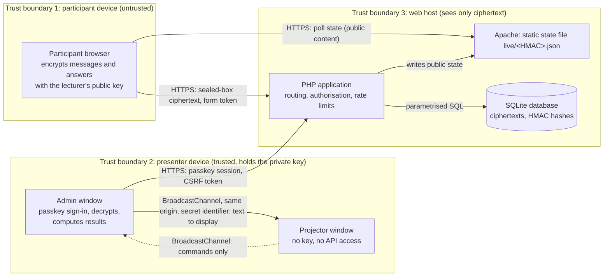

# Threat model

[Suomi](uhkamalli.md) · **English**

The threat model of HessuTalks: architecture, trust boundaries and a STRIDE analysis. Every threat refers to the
requirement (R) and acceptance test (H) it is verified by, and to the automated test that checks it.
Detailed controls and residual risks: [SECURITY.en.md](../SECURITY.en.md). Acceptance tests: [hyvaksymistestit.en.md](hyvaksymistestit.en.md).

## Architecture and trust boundaries

| Component | Trusted for | Holds |
|---|---|---|
| Participant browser | Nothing: any client can be modified | Random device identifier, the lecturer's public key |
| Presenter browser (admin window) | Decryption and result computation | Private key in memory, unlocked with a passkey (PRF) or passphrase |
| Projector window | Displaying text only | No key, no API access, listens only to the channel chosen by the admin view (identifier in the URL fragment) |
| Server (PHP, Apache) | Authorisation, rate limits, availability | Ciphertexts, HMAC hashes, public poll content; never plaintext messages or answers |
| Database (SQLite) | Storage | As above; outside the web root |

Data crossing the boundaries:
- **1 → 3:** only ciphertext (libsodium `crypto_box_seal`) and public identifiers. The server cannot read messages, nicknames or answers.
- **3 → 1:** only public content published by the lecturer (question, options, correct answer after the reveal).
- **3 → 2:** ciphertexts; decrypted only in the presenter's browser.
- **2 → screen and Teams:** what the projector shows is public to the room and to remote participants.

## STRIDE

| STRIDE | Threat | Req. / test | Mitigation | Verified by |
|---|---|---|---|---|
| **Tampering** | Fake votes: a script floods a poll with answers to change the result | R20 / H9 | One answer per question per device (later answers replace the earlier one). 10 answers per minute per device and question (429), 600 per minute per address dropped silently, maximum 3000 per poll | PHPUnit `testScriptedRepeatAnswersCountOnceAndAreRateLimited`, `testAddressRateLimitDropsSilentlyAndForgetsAddress`, `testSameBrowserReplacesItsAnswer` |
| **Elevation of privilege** | A participant controls polls (opens, closes, reveals) by calling the presenter API | R18 / H8 | All presenter routes require a passkey session and are authorised on the server. CSRF token, exact Origin check | PHPUnit `testAdminPollRoutesRequireLogin` (all poll, set and control routes → 401), `testProtectedRoutesRequireLogin`, `testPostWithoutCsrfTokenIsRejected` |
| **Tampering / injection** | Script in an open-text answer or word cloud word (XSS) runs in the presenter's or projector's browser | R19 / H6 | Decrypted content is inserted only with `textContent`. Strict CSP without inline scripts. The server limits the ciphertext size per question (`config.max` 280–3500 characters); the lecturer's browser rejects longer texts | Browser `open-text.mjs` (`<script>` and `` shown as text), Node `results.test.mjs`, PHPUnit `testBrowserScriptsNeverUseHtmlInjectionSinks`, `testLongOpenAnswerLimitIsPerQuestion`, `testTemplatesContainNoInlineScripts` |
| **Spoofing** | Someone signs in as the lecturer | R18 | Passkey (WebAuthn) only, bound to the origin. Single-use challenges, rate-limited sign-in, session timeouts | PHPUnit `testLoginChallengeIsSingleUse`, `testLoginIsRateLimited`, `testRegistrationWithWrongOriginFails`, `testIdleAndAbsoluteTimeouts` |
| **Spoofing** | A participant posts with someone else's nickname | – | The nickname claim is bound to a random 256-bit owner identifier; the server stores only hashes | PHPUnit `testCannotPostWithSomeoneElsesNickname`, `testNicknameClaimFromOtherEventDoesNotWork` |
| **Repudiation** | The lecturer denies an administrative action, or a participant denies an answer | – | Security-relevant admin actions (sign-ins and failures, key and passkey changes, imports, resets, deletions) are written to the security log, shown in the admin view. Participants are anonymous by design: answers cannot be attributed, which is an accepted consequence of data minimisation | PHPUnit `testLoginFailures`, `testPrfWrapRoundTripThroughLogin` (log entries) |
| **Information disclosure** | Database or backup leaks | R22 | Messages, nicknames and answers exist only encrypted; nicknames only as HMAC hashes; no IP addresses or cookies for participants | PHPUnit `testAnswerStoresOnlyCiphertextAndNoVoterSecret`, `testHappyPathStoresOnlyCiphertext`, `testParticipantResponsesSetNoCookies` |
| **Information disclosure** | Correct answers and explanations are seen before the reveal (developer tools) | – | The participant API and the state file contain only public fields until the reveal | PHPUnit `testRevealSendsAnswerKeyOnlyAfterReveal`, `testImportedAnswerKeyIsNotSentToParticipants`, `testFileEqualsApiLiveAndHidesAnswerKeyUntilReveal` |
| **Denial of service** | 150+ participants exhaust the shared host's PHP processes during a lecture | H13 | Participants read the poll state from a static file served by Apache without PHP; rate limits; deploy freeze during lectures | Load test `scripts/e2e.sh load.mjs` and in production `scripts/load-test.mjs` (150 participants, 0 errors), PHPUnit `testApacheServesOnlyAppFilesWithoutPhpOrCache` |
| **Tampering** (supply chain) | A compromised dependency or CI tool changes the delivered code | R25, R26 | Actions pinned to commit SHAs, browser libraries and Trivy pinned to SHA-256 hashes, SCA stops on CRITICAL, SBOM for every build | PHPUnit `PipelineSecurityTest`, `scripts/verify-vendor.sh` (CI) |

## Residual risks

- **Server takeover:** browser-based end-to-end encryption relies on the JavaScript the server delivers. An attacker who
  can change files on the web host can leak *future* messages; stored messages stay protected. See SECURITY.en.md.
- **Multiplying votes:** respondents are not identified, so a modified client can create new device identifiers.
  The limits above bound the effect. Polls suit surveying opinions and knowledge, not decisions with consequences.
- **Projector and Teams:** everything shown on the projector is public to the room and to remote participants.
  The presenter decides what is shown and can hide any answer or word immediately (R21, H7).
