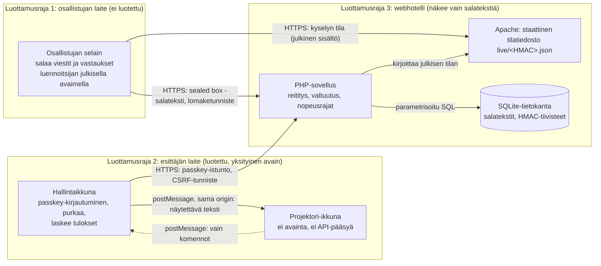

# Uhkamalli

**Suomi** · [English](threat-model.md)

HessuTalksin uhkamalli: arkkitehtuuri, luottamusrajat ja STRIDE-analyysi. Jokainen uhka viittaa vaatimukseen (R) ja
hyväksymistestiin (H), joilla se todennetaan, sekä automaattiseen testiin, joka sen tarkistaa.
Tarkemmat kontrollit ja jäännösriskit: [SECURITY.md](../SECURITY.md). Hyväksymistestit: [hyvaksymistestit.md](hyvaksymistestit.md).

## Arkkitehtuuri ja luottamusrajat

| Komponentti | Luotettu tehtävään | Sisältää |
|---|---|---|
| Osallistujan selain | Ei mihinkään: kuka tahansa voi muokata asiakasta | Satunnainen laitetunniste, luennoitsijan julkinen avain |
| Esittäjän selain (hallintaikkuna) | Purkaminen ja tulosten laskenta | Yksityinen avain muistissa, avattu passkeylla (PRF) tai tunnuslauseella |
| Projektori-ikkuna | Vain tekstin näyttäminen | Ei avainta, ei API-pääsyä, hyväksyy viestit vain avaajaltaan |
| Palvelin (PHP, Apache) | Valtuutus, nopeusrajat, saatavuus | Salatekstit, HMAC-tiivisteet, kyselyjen julkinen sisältö; ei koskaan selväkielisiä viestejä tai vastauksia |
| Tietokanta (SQLite) | Tallennus | Kuten yllä; webrootin ulkopuolella |

Rajojen yli kulkeva tieto:
- **1 → 3:** vain salatekstiä (libsodium `crypto_box_seal`) ja julkisia tunnisteita. Palvelin ei voi lukea viestejä, nimimerkkejä eikä vastauksia.
- **3 → 1:** vain luennoitsijan julkaisemaa sisältöä (kysymys, vaihtoehdot, oikea vastaus paljastuksen jälkeen).
- **3 → 2:** salatekstit; puretaan vain esittäjän selaimessa.
- **2 → näyttö ja Teams:** projektorin sisältö on julkista salille ja etäosallistujille.

## STRIDE

| STRIDE | Uhka | Vaat. / testi | Suojaus | Todennus |
|---|---|---|---|---|
| **Tampering** (peukalointi) | Väärennetyt äänet: skripti lähettää kyselyyn vastauksia tuloksen muuttamiseksi | R20 / H9 | Yksi vastaus kysymystä ja laitetta kohden (uusi korvaa vanhan). 10 vastausta minuutissa laitetta ja kysymystä kohden (429), 600 minuutissa osoitetta kohden hiljaisesti hylättynä, enintään 3000 kyselyä kohden | PHPUnit `testScriptedRepeatAnswersCountOnceAndAreRateLimited`, `testAddressRateLimitDropsSilentlyAndForgetsAddress`, `testSameBrowserReplacesItsAnswer` |
| **Elevation of privilege** (oikeuksien korotus) | Osallistuja ohjaa kyselyitä (avaa, sulkee, paljastaa) kutsumalla esittäjän rajapintaa | R18 / H8 | Kaikki esittäjän reitit vaativat passkey-istunnon, ja valtuutus tarkistetaan palvelimella. CSRF-tunniste, tarkka Origin-vertailu | PHPUnit `testAdminPollRoutesRequireLogin` (kaikki kysely-, sarja- ja ohjausreitit → 401), `testProtectedRoutesRequireLogin`, `testPostWithoutCsrfTokenIsRejected` |
| **Tampering / injektio** | Skripti avoimessa vastauksessa tai sanapilven sanassa (XSS) suoritetaan esittäjän tai projektorin selaimessa | R19 / H6 | Purettu sisältö lisätään vain `textContent`illa. Tiukka CSP ilman inline-skriptejä. Palvelin rajaa salatekstin koon kysymyksen asetuksen mukaan (`config.max` 280–3500 merkkiä); luennoitsijan selain hylkää pidemmät tekstit | Selain `open-text.mjs` (`<script>` ja `` näkyvät tekstinä), Node `results.test.mjs`, PHPUnit `testBrowserScriptsNeverUseHtmlInjectionSinks`, `testLongOpenAnswerLimitIsPerQuestion`, `testTemplatesContainNoInlineScripts` |
| **Spoofing** (tekeytyminen) | Joku kirjautuu luennoitsijana | R18 | Vain passkey (WebAuthn), sidottu originiin. Kertakäyttöiset haasteet, kirjautumisen nopeusraja, istuntojen aikakatkaisut | PHPUnit `testLoginChallengeIsSingleUse`, `testLoginIsRateLimited`, `testRegistrationWithWrongOriginFails`, `testIdleAndAbsoluteTimeouts` |
| **Spoofing** (tekeytyminen) | Osallistuja lähettää toisen nimimerkillä | – | Nimimerkin varaus on sidottu satunnaiseen 256-bittiseen omistajatunnisteeseen; palvelimella vain tiivisteet | PHPUnit `testCannotPostWithSomeoneElsesNickname`, `testNicknameClaimFromOtherEventDoesNotWork` |
| **Repudiation** (kiistäminen) | Luennoitsija kiistää hallintatoimen, tai osallistuja kiistää vastauksensa | – | Tietoturvan kannalta olennaiset hallintatoimet (kirjautumiset ja epäonnistumiset, avain- ja passkey-muutokset, tuonnit, nollaukset, poistot) kirjataan tietoturvalokiin, joka näkyy hallinnassa. Osallistujat ovat tarkoituksella anonyymejä: vastauksia ei voi kohdistaa, mikä on hyväksytty tietojen minimoinnin seuraus | PHPUnit `testLoginFailures`, `testPrfWrapRoundTripThroughLogin` (lokimerkinnät) |
| **Information disclosure** (tietovuoto) | Tietokanta tai varmuuskopio vuotaa | R22 | Viestit, nimimerkit ja vastaukset ovat vain salattuina; nimimerkit vain HMAC-tiivisteinä; osallistujista ei IP-osoitteita eikä evästeitä | PHPUnit `testAnswerStoresOnlyCiphertextAndNoVoterSecret`, `testHappyPathStoresOnlyCiphertext`, `testParticipantResponsesSetNoCookies` |
| **Information disclosure** (tietovuoto) | Oikeat vastaukset ja selitykset nähdään ennen paljastusta (kehitystyökalut) | – | Osallistujan rajapinnassa ja tilatiedostossa on vain julkiset kentät paljastukseen asti | PHPUnit `testRevealSendsAnswerKeyOnlyAfterReveal`, `testImportedAnswerKeyIsNotSentToParticipants`, `testFileEqualsApiLiveAndHidesAnswerKeyUntilReveal` |
| **Denial of service** (palvelunesto) | 150+ osallistujaa kuluttaa webhotellin PHP-prosessit loppuun luennon aikana | H13 | Osallistujat lukevat kyselyn tilan staattisesta tiedostosta, jonka Apache palvelee ilman PHP:tä; nopeusrajat; julkaisujäädytys luentojen aikana | Kuormitustesti `scripts/e2e.sh load.mjs` ja tuotannossa `scripts/load-test.mjs` (150 osallistujaa, 0 virhettä), PHPUnit `testApacheServesOnlyAppFilesWithoutPhpOrCache` |
| **Tampering** (toimitusketju) | Kaapattu riippuvuus tai CI-työkalu muuttaa toimitettavaa koodia | R25, R26 | Actionit lukittu commit-SHA:han, selainkirjastot ja Trivy SHA-256-summiin, SCA pysähtyy CRITICAL-löydökseen, SBOM jokaisesta käännöksestä | PHPUnit `PipelineSecurityTest`, `scripts/verify-vendor.sh` (CI) |

## Jäännösriskit

- **Palvelimen kaappaus:** selainpohjainen päästä päähän -salaus luottaa palvelimen toimittamaan JavaScriptiin. Hyökkääjä,
  joka voi muuttaa webhotellin tiedostoja, voi vuotaa *tulevia* viestejä; tallennetut viestit pysyvät suojattuina. Ks. SECURITY.md.
- **Äänten monistaminen:** vastaajia ei tunnisteta, joten muokattu asiakas voi luoda uusia laitetunnisteita.
  Yllä olevat rajat rajoittavat vaikutusta. Kyselyt sopivat mielipiteiden ja osaamisen kartoitukseen, eivät seurauksellisiin päätöksiin.
- **Projektori ja Teams:** kaikki projektorilla näkyvä on julkista salille ja etäosallistujille.
  Esittäjä päättää, mitä näytetään, ja voi piilottaa minkä tahansa vastauksen tai sanan heti (R21, H7).
