# HessuTalks user guide

[Suomi](kayttoohje.md) · **English**

HessuTalks is a question, feedback and poll channel for lectures. Participants join on their phones with a code or
QR code, ask questions under a nickname and answer polls. All messages and answers are encrypted on the participant's
device, and only the lecturer can read them.

In the pictures, a red frame marks the button or area being described. The number on the frame refers to the list below the picture.

**Contents**

1. [Getting started](#1-getting-started)
2. [Creating a lecture](#2-creating-a-lecture)
3. [Preparing questions](#3-preparing-questions)
4. [Participant view](#4-participant-view)
5. [During the lecture: questions on the board](#5-during-the-lecture-questions-on-the-board)
6. [Results and moderation](#6-results-and-moderation)
7. [Free-form questions and feedback](#7-free-form-questions-and-feedback)
8. [Settings and signing in](#8-settings-and-signing-in)
9. [Keyboard shortcuts](#9-keyboard-shortcuts)

The admin view is always in Finnish, so this guide gives the Finnish button label followed by its meaning in brackets. Participant pages and projector texts are in English or Finnish according to the lecture language.

## 1. Getting started

Setup is done once. You need the setup token, which is printed when the administrator creates the configuration
file, and a device that supports passkeys (e.g. Touch ID, Face ID, Windows Hello or a security key).

### 1.1 Enable the admin view

Open the admin view. The administrator gives you its address.

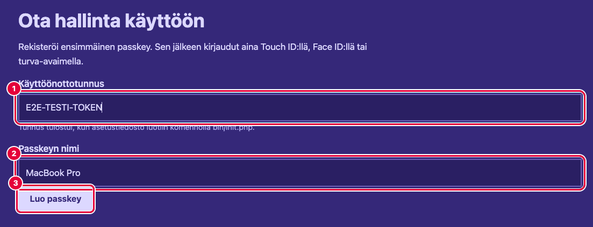

1. **Käyttöönottotunnus** (setup token): paste the token here.
2. **Passkeyn nimi** (passkey name): a device name to recognise the passkey later (e.g. *MacBook Pro*).
3. **Luo passkey** (create passkey): the browser asks you to confirm with a fingerprint, face or PIN. There is no password.

### 1.2 Create encryption keys

Messages are encrypted with a public key. They can only be opened with the private key, which is protected by a passphrase.

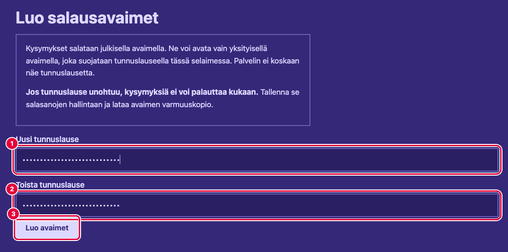

1. **Uusi tunnuslause** (new passphrase): at least 12 characters. Store it in a password manager.
2. **Toista tunnuslause** (repeat passphrase).
3. **Luo avaimet** (create keys): the browser downloads a key backup. Keep it safe.

> **Important:** if both the passphrase and the backup are lost, nobody can open the messages. The server never sees the passphrase.

## 2. Creating a lecture

### 2.1 New lecture

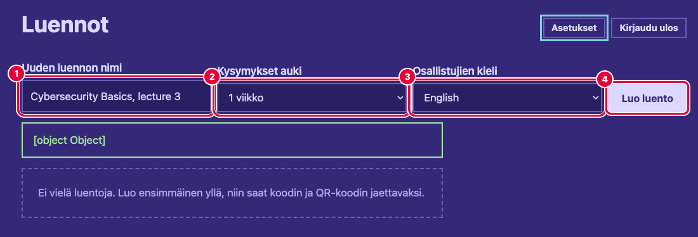

1. **Uuden luennon nimi** (name of the new lecture): shown to participants.
2. **Kysymykset auki** (questions open): how long participants can send messages (3 hours, a day, a week or until you close it).
3. **Osallistujien kieli** (participants' language): *English*, *Suomi* or by browser language. Participants can still switch language.
4. **Luo luento** (create lecture): opens the lecture page.

One lecture can cover a whole course: participants use the same code and nickname every time.

### 2.2 Lecture page: code and QR code

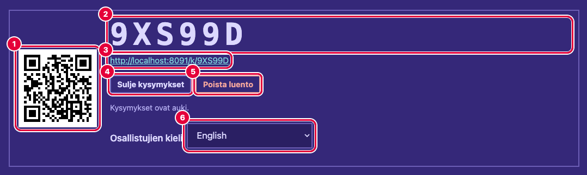

1. **QR code**: show it on a slide or the projector. Participants join by scanning it.
2. **Join code**: six characters that can be typed on the home page.
3. **Link** to the participant page. Open it to see the participant view.
4. **Sulje kysymykset** (close questions): participants can no longer send messages. On a closed lecture the button reads *Avaa kysymykset* (open questions).
5. **Poista luento** (delete lecture): deletes the lecture and all its messages permanently.
6. **Osallistujien kieli** (participants' language): can be changed later. Projector texts change too.

### 2.3 Toolbar

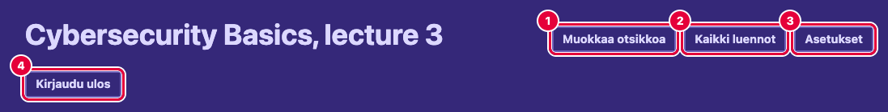

1. **Muokkaa otsikkoa** (edit title): fixes the lecture name. The code and QR code stay the same, so links on slides keep working.
2. **Kaikki luennot** (all lectures): the lecture list.
3. **Asetukset** (settings): passkeys, encryption key and security log (see [section 8](#8-settings-and-signing-in)).
4. **Kirjaudu ulos** (sign out).

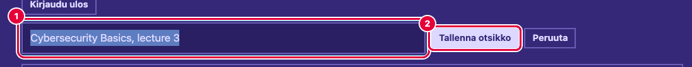

1. Type the new title.
2. **Tallenna otsikko** (save title).

### 2.4 Lecture list

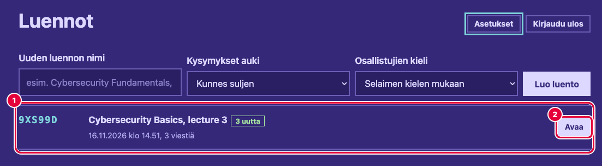

1. A lecture row shows the code, name, number of new messages, creation time and number of messages.
2. **Avaa** (open): the lecture page.

## 3. Preparing questions

Prepared questions are on the **Kysymykset** (questions) tab in **question sets**, for example one set per module or
session. Prepare the sets before the lecture. You show the questions during the lecture from the same list (see [section 5](#5-during-the-lecture-questions-on-the-board)).

### 3.1 Questions tab tools

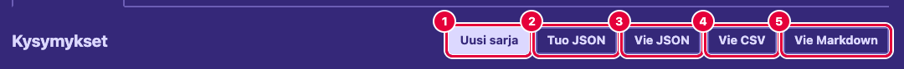

1. **Uusi sarja** (new set).
2. **Tuo JSON** (import JSON): sets from a file (see [3.5](#35-import-and-export)).
3. **Vie JSON** (export JSON): all sets to a file, for example for the next run of the course.
4. **Vie CSV** (export CSV): results as a table (Excel opens it directly).
5. **Vie Markdown** (export Markdown): a lecture report: questions, results and the participants' messages.

### 3.2 New question set

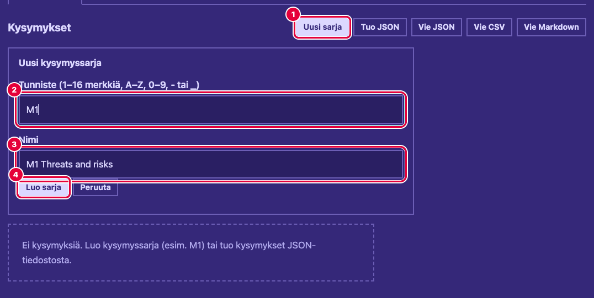

1. **Uusi sarja** (new set) opens the form.
2. **Tunniste** (identifier): a short code, e.g. `M1` (1–16 characters: A–Z, 0–9, - or _).
3. **Nimi** (name): the set title.
4. **Luo sarja** (create set).

### 3.3 New question

Press **Uusi kysymys** (new question) on the set row.

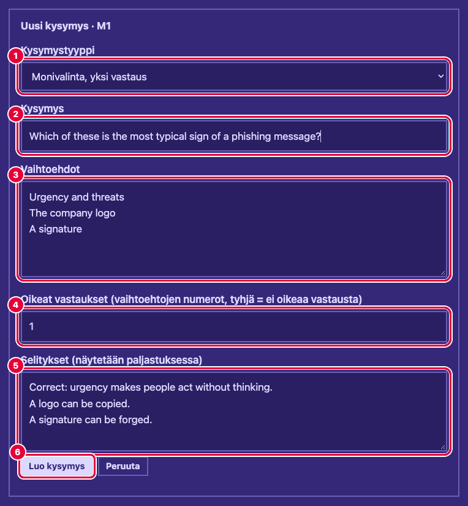

1. **Kysymystyyppi** (question type, see the table below).
2. **Kysymys** (question): at most 300 characters.
3. **Vaihtoehdot** (options): one option per line, 2–10 options.
4. **Oikeat vastaukset** (correct answers): option numbers, e.g. `1` or `1, 3`. Leave empty if there is no correct answer.
5. **Selitykset** (explanations): an optional explanation for each option on its own line. Shown when you reveal the correct answer.
6. **Luo kysymys** (create question). A new question is a **draft**: participants do not see it until you show it on the board.

Correct answers and explanations are not sent to participants before the reveal.

| Question type | Participant answers | Results |
|---|---|---|
| Monivalinta, yksi vastaus (multiple choice, one answer) | picks one | bars and percentages |
| Monivalinta, useita vastauksia (multiple choice, several answers) | picks one or more | bars and percentages |
| Sanapilvi (word cloud) | 1–3 words | word cloud, most common largest |
| Likert-asteikko (Likert scale) | 5 or 7 points | distribution, mean and median |
| Asteikko 0–10 (scale 0–10) | a number 0–10 | distribution, mean and median |
| Avoin teksti (open text) | free text | list, newest first |

Open text has its own settings:

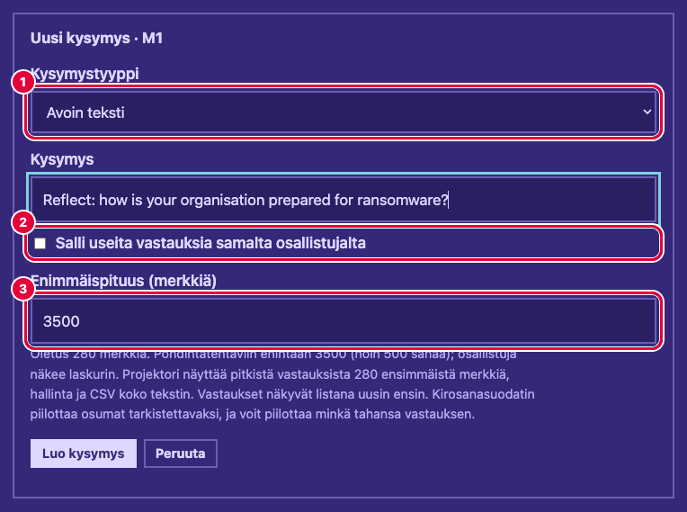

1. **Kysymystyyppi** (question type): *Avoin teksti* (open text).
2. **Salli useita vastauksia** (allow several answers): a participant can send more than one answer. Otherwise a new answer replaces the previous one.
3. **Enimmäispituus** (maximum length): 280 characters by default. For reflection tasks up to 3,500 characters (about 500 words).

### 3.4 Set and question buttons

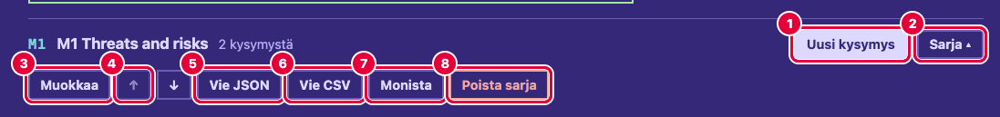

1. **Uusi kysymys** (new question).
2. **Sarja ▾** (set): shows or hides the set's tools.
3. **Muokkaa** (edit): identifier and name.
4. **↑ ↓**: move the set up or down.
5. **Vie JSON** (export JSON): the set to a file.
6. **Vie CSV** (export CSV): the set's results as a table.
7. **Monista** (duplicate): a copy of the set and its questions without answers.
8. **Poista sarja** (delete set): the set, its questions and answers permanently.

Editing a question happens below it. Click the question's row to open its results and editing buttons:

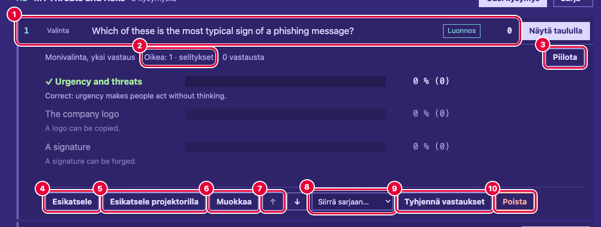

1. **The question row**: a click opens and closes the part below it.
2. The correct answers are shown only to you (*Oikea: 1 · selitykset*, correct: 1 · explanations).
3. **Piilota** (hide): closes the part.
4. **Esikatsele** (preview): the question as participants see it (a phone-sized window). No answer is sent.
5. **Esikatsele projektorilla** (preview on projector): the question in the presenter view in its own window.
6. **Muokkaa** (edit): question text, options and correct answers. The type cannot be changed.
7. **↑ ↓**: move the question within the set.
8. **Siirrä sarjaan…** (move to set): moves the question with its answers to another set.
9. **Tyhjennä vastaukset** (clear answers): deletes the question's answers after confirmation.
10. **Poista** (delete): the question and its answers permanently after confirmation.

Clearing answers and deleting are only here, so that answers given during the lecture are not deleted by accident.
A question that has been on the board also has **Palauta luonnokseksi** (return to draft): the question leaves the board
and the participants, and results and the correct answer are hidden again. Given answers are kept.

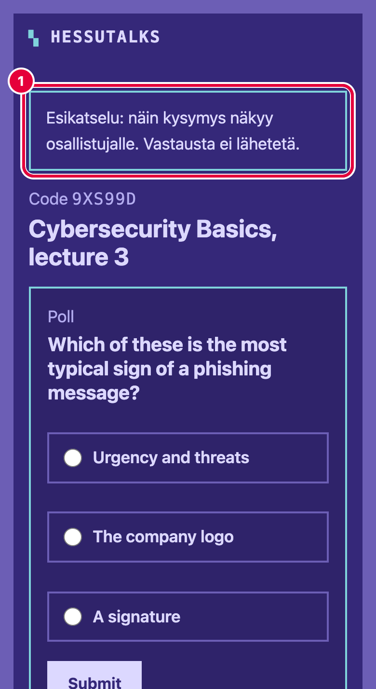

1. The preview has a notice at the top that no answer is sent.

### 3.5 Import and export

Questions can be written into a file and imported at once. The file format is described in a separate guide,
[Question import file](import-format.md). When you give an AI your learning material and that description, it can
produce an import file directly from the material.

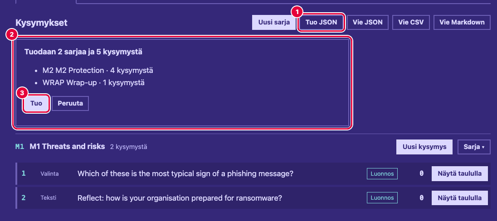

1. **Tuo JSON** (import JSON): choose the file.
2. The summary shows the sets and questions to import and any errors. Nothing is saved yet.
3. **Tuo** (import): saves the sets. If the file has an error, nothing is imported.

Reports:

- **Vie CSV** (export CSV): question, option or text, answer count and timestamp. No participant identifiers.
- **Vie Markdown** (export Markdown): a report of the whole lecture: results as tables, correct answers, open answers
  and participants' questions and feedback. No nicknames.

Answers are decrypted for the reports in your own browser. The server does not see the report contents.

## 4. Participant view

### 4.1 Joining

A participant scans the QR code or opens the home page and types the code.

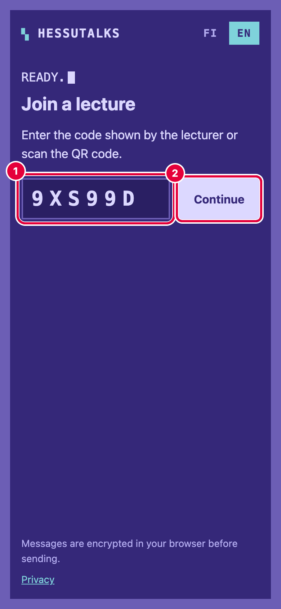

1. **Lecture code**: the lecture's six-character code.
2. **Continue**.

### 4.2 Lecture page

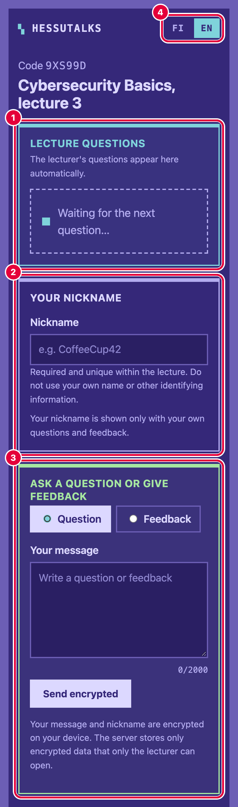

1. **Lecture questions**: questions opened by the lecturer appear here automatically within about a second.
2. **Nickname**: required and unique within the lecture. The nickname is only for messages. Polls are answered without it.
3. **Ask a question or give feedback**.
4. **FI / EN**: switch language.

### 4.3 Question or feedback

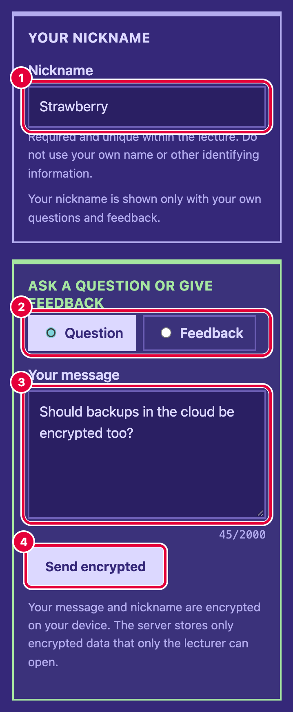

1. **Nickname**: e.g. *Strawberry*. Do not use your own name.
2. **Question** or **Feedback**.
3. **Your message**: at most 2,000 characters.
4. **Send encrypted**: the message and nickname are encrypted on the device before sending.

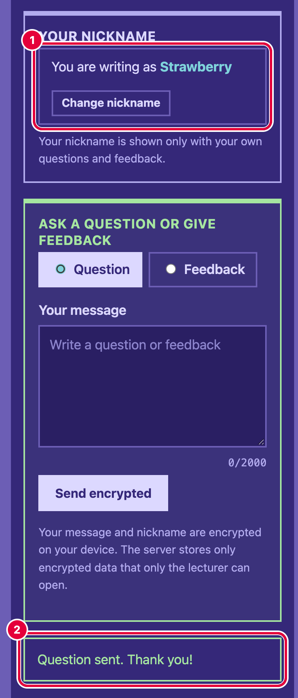

1. The nickname is now reserved for this browser. At the next lecture it is suggested automatically.
2. Confirmation of the sent message.

### 4.4 Answering a poll

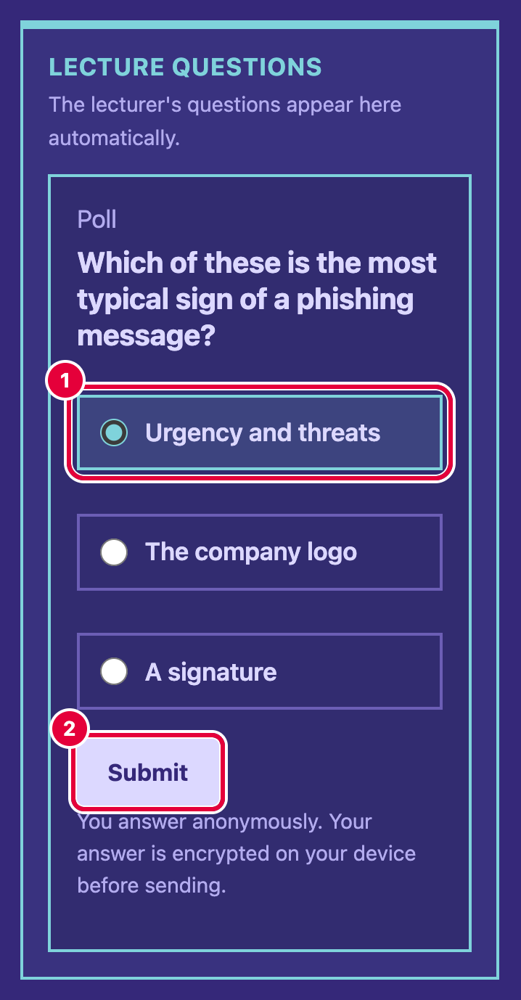

1. Choose an option.
2. **Submit**. The answer can be changed until the poll is closed.

When you show the results and reveal the correct answer, participants see them on their own phones:

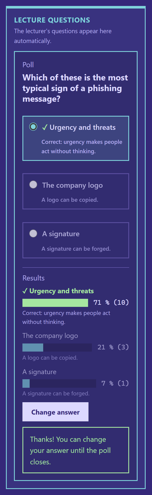

If several questions are on the board, they are shown one below the other, and participants can answer all open ones:

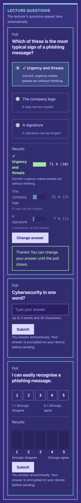

## 5. During the lecture: questions on the board

During the lecture everything happens in two places: the **board row** at the top of the lecture page and the
**question row** on the Kysymykset (questions) tab. There are no separate modes and no active question.

### 5.1 Board and presenter screen

The presenter screen is its own window for the projector or Teams sharing. Connect the projector as an extended display (not mirrored),
so the admin view stays on the laptop screen.

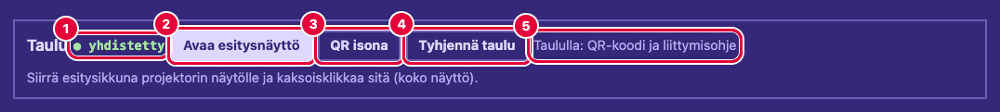

1. The status shows whether the presenter screen is connected.
2. **Avaa esitysnäyttö** (open presenter screen): opens the window. Chrome and Edge move it to the other display (the browser asks for permission once).
   In other browsers, drag the window to the projector. Double-click or **F** toggles full screen.
   **Näytä taululla** (show on board) also opens the window if it is not open.
3. **QR isona** (large QR): a large QR code over the whole screen (also **Q**). It moves aside when you bring something to the board.
4. **Tyhjennä taulu** (clear board): everything off the board. Questions on the board are closed, and answers are kept.
5. What is on the board now.

When nothing is on the board, it shows the QR code and joining instructions:

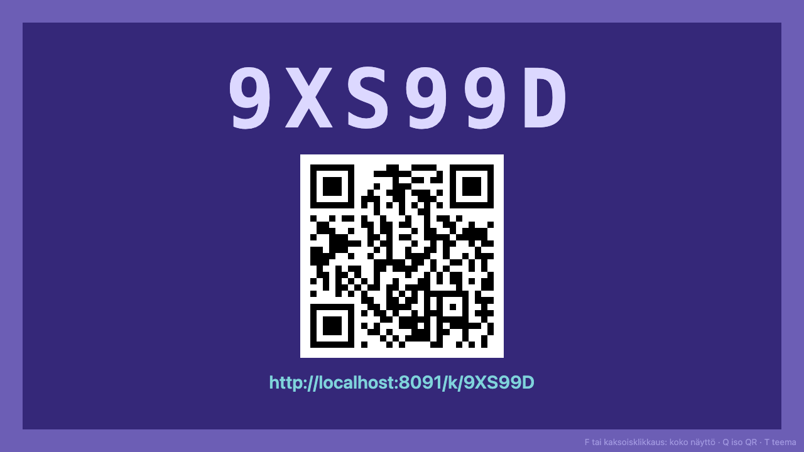

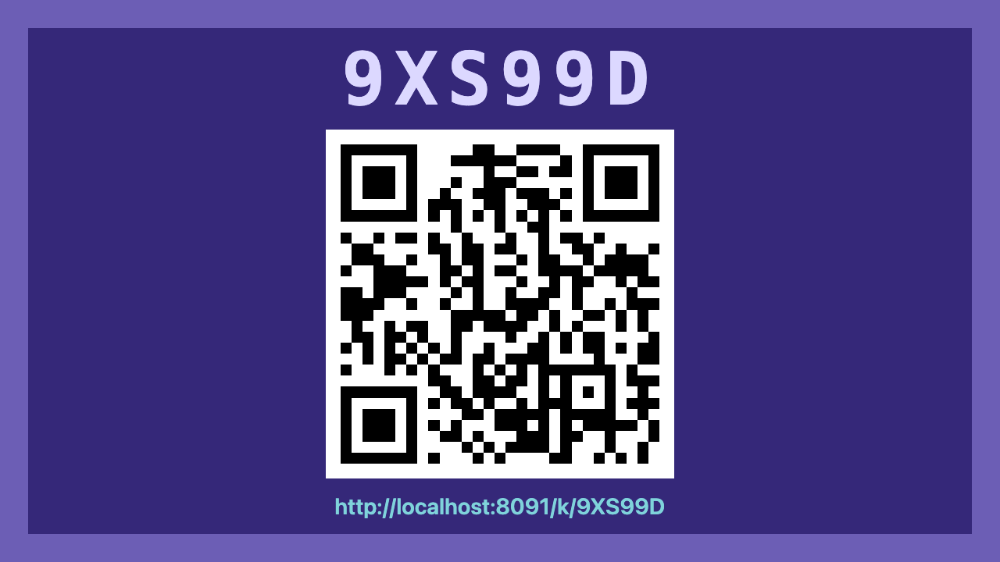

### 5.2 The question row

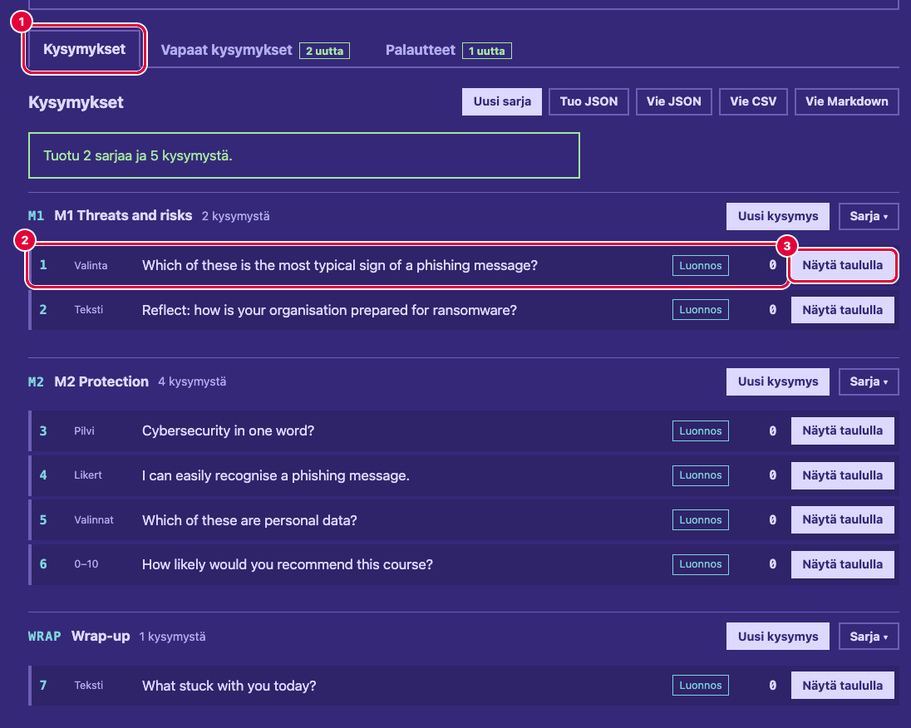

1. **Kysymykset** (questions) tab: the prepared questions by set, numbered.
2. **The question row**: a click opens the results and editing below the row (see [section 6](#6-results-and-moderation)).
3. **Näytä taululla** (show on board): the question to the projector next to the others and open for answers with one button.

When the question is on the board, the row's buttons change:

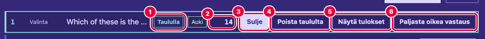

1. **Taululla** (on board) and the status (*Auki*, open, or *Suljettu*, closed).
2. The answer count.
3. **Sulje** (close): no more answers are accepted. The question stays on the board, and **Avaa vastauksille** (open for answers) reopens it.
4. **Poista taululta** (remove from board): the question off the projector and the participants' phones. Answers are kept, and
   **Näytä taululla** opens the question again.
5. **Näytä tulokset** (show results): results to the projector and the participants' phones. Results are hidden at first.
6. **Paljasta oikea vastaus** (reveal correct answer): highlights the correct options and shows the explanations. Shown only if the question has a correct answer.

### 5.3 On the projector

An open question on the projector. Results are hidden until you show them:

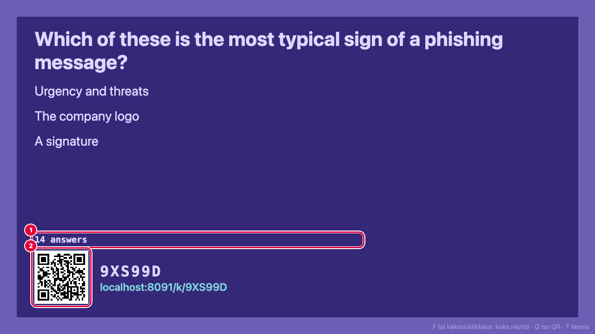

1. The answer count updates within about a second.
2. The QR code and join code are always at the bottom for latecomers.

Results and the revealed correct answer:

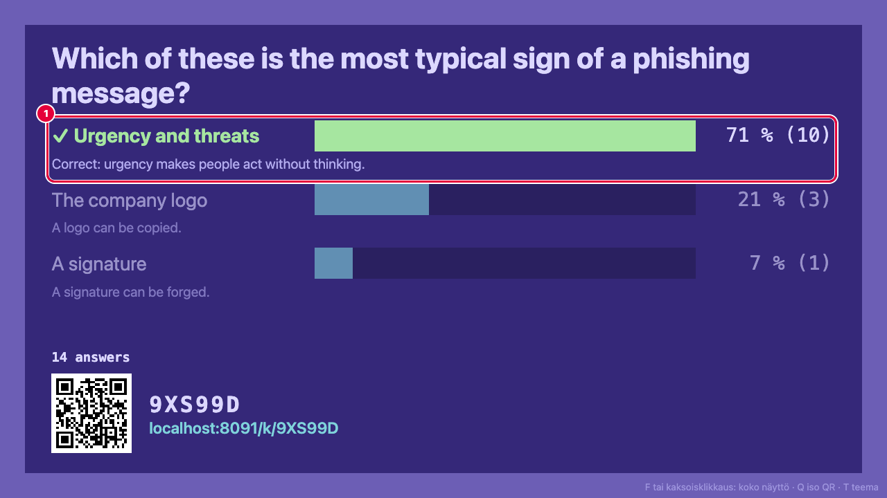

1. The correct option is highlighted, and the explanations are shown below the options.

### 5.4 Several questions on the board

You can keep several questions on the board at once, for example an opening poll and a word cloud. Press **Näytä taululla**
on each question's row. Each one is controlled from its own buttons.

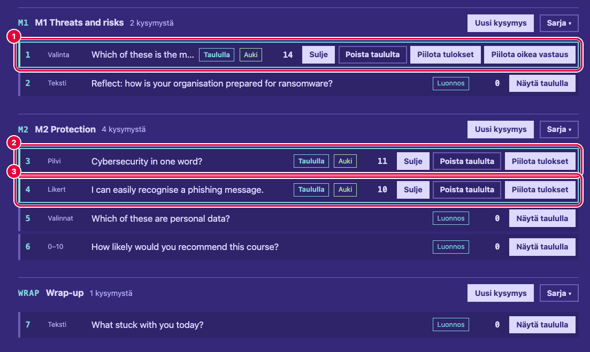

In the picture three questions (1–3) are on the board and open. **Sulje** and **Poista taululta** affect only their own question.

The projector shows the questions as a grid (at most 12), and the text size is fitted to the tile:

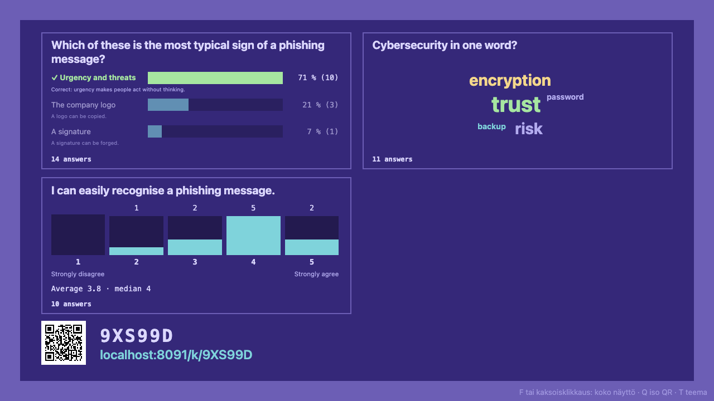

## 6. Results and moderation

Results are computed in your browser, because the answers are encrypted. Keep the admin view open during the lecture.
Click a question's row to open its results below it:

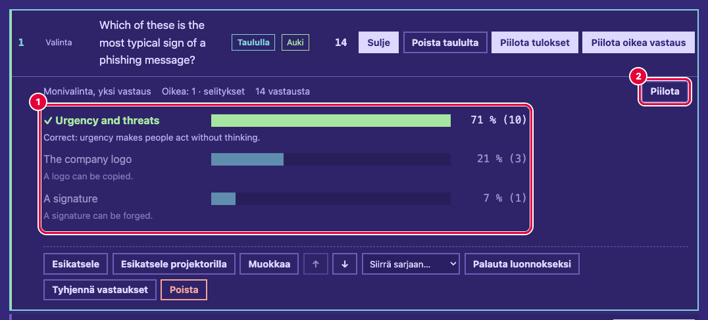

1. Results. In the admin view the numbers and correct answers are always shown, even when they are hidden on the projector.
2. **Piilota** (hide): closes the results. The question stays on the board.

### 6.1 Word cloud

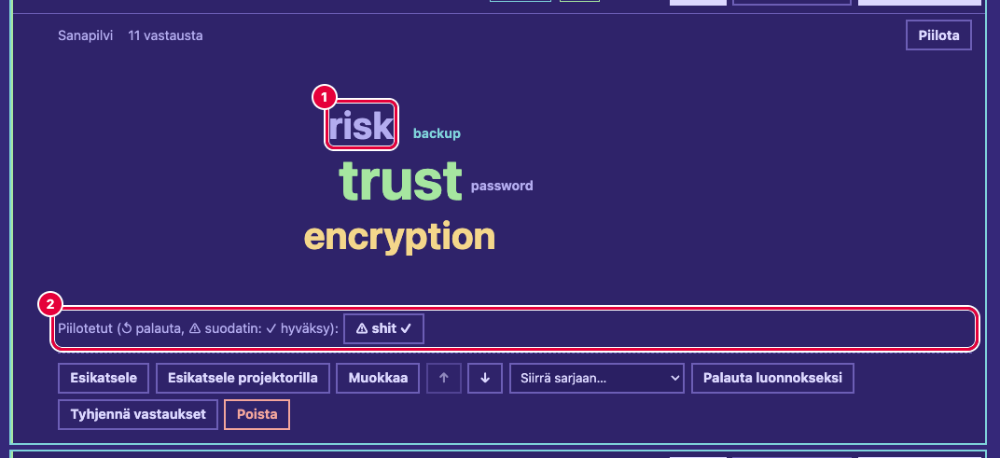

1. **Click a word**: the word is hidden and disappears from the projector immediately.
2. **Piilotetut** (hidden): ↺ restores a word. The profanity filter (English and Finnish) hides matches automatically
   with the mark ⚠. Approve them with ✓ if they are appropriate.

### 6.2 Open answers

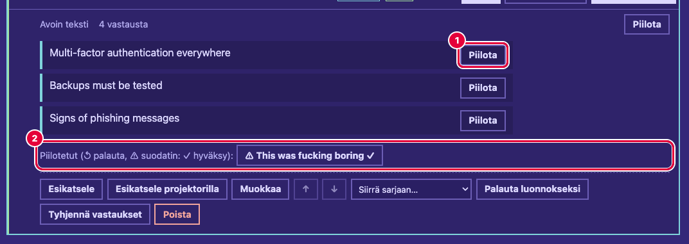

1. **Piilota** (hide): the answer disappears from the projector immediately.
2. **Piilotetut** (hidden): hidden answers and those stopped by the filter. Restore or approve them when needed.

Hidden items are stored on the server encrypted, so they persist when you reload the page.

## 7. Free-form questions and feedback

The participants' free-form questions and feedback are on their own tabs, newest first.

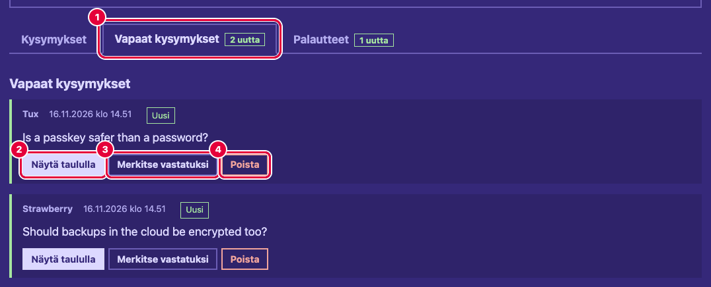

1. **Vapaat kysymykset** (free-form questions) tab. The badge shows the number of new ones. The **Palautteet** (feedback) tab works the same way.
2. **Näytä taululla** (show on board): the message large on the projector next to other content. **Poista taululta** (remove from board) takes it off.
   At most 6 messages can be on the board at a time.
3. **Merkitse vastatuksi** (mark answered; for feedback **Merkitse käsitellyksi**, mark handled). **Palauta uudeksi** (back to new) undoes it.
4. **Poista** (delete): the message permanently.

A question and feedback on the projector:

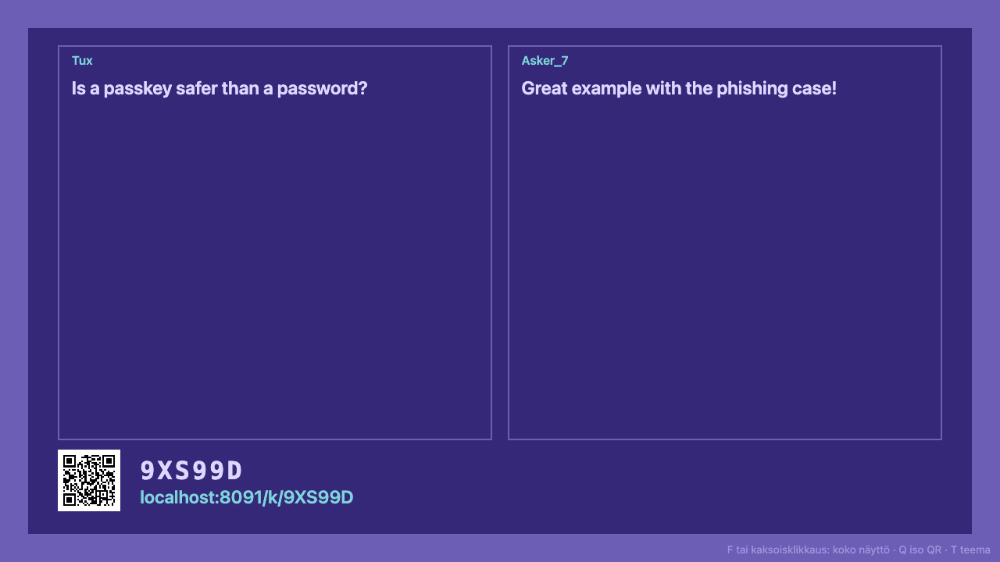

## 8. Settings and signing in

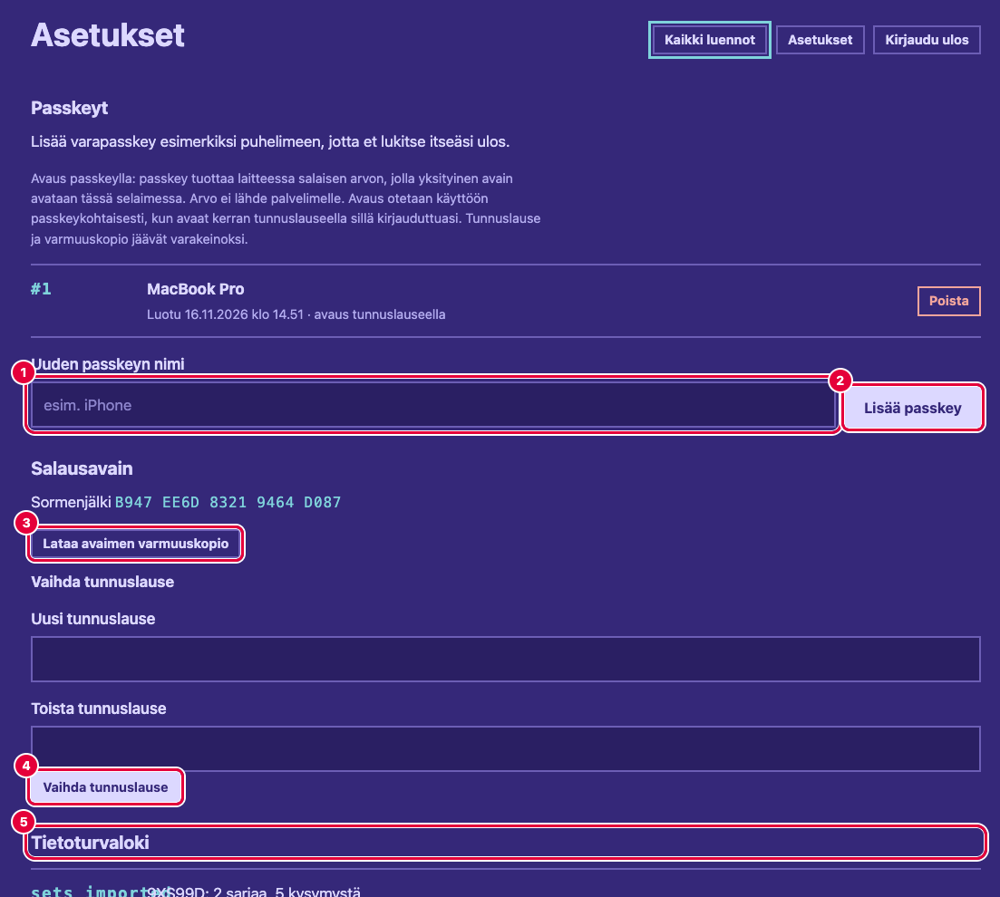

1. **Uuden passkeyn nimi** (new passkey name): e.g. *iPhone*.
2. **Lisää passkey** (add passkey): add a backup passkey on another device so you do not lock yourself out.
3. **Lataa avaimen varmuuskopio** (download key backup).
4. **Vaihda tunnuslause** (change passphrase): type the new passphrase twice. A new backup is downloaded.
5. **Tietoturvaloki** (security log): sign-ins and admin changes.

When you open the admin view in a new window or on another device, the messages are unlocked first:

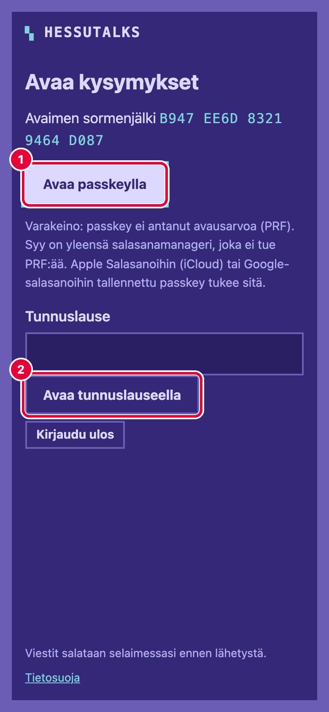

1. **Avaa passkeylla** (unlock with passkey): opens the messages if the passkey supports unlocking (PRF).
2. **Avaa tunnuslauseella** (unlock with passphrase): a fallback if the passkey cannot unlock the key.

Signing in:

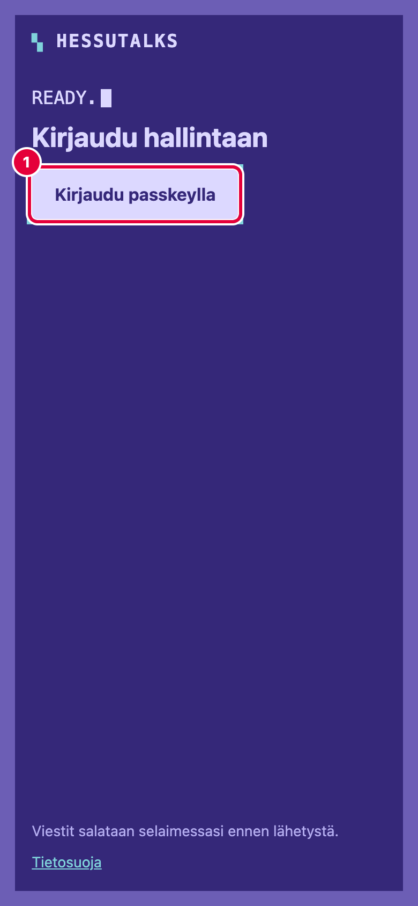

1. **Kirjaudu passkeylla** (sign in with passkey). If the passkey supports unlocking (PRF), the messages open at the same time.
   Otherwise type the passphrase once, after which the passkey is enough.

A session ends after 3 hours of inactivity and after 8 hours at the latest. The presenter screen is cleared when you
sign out or close the admin view.

## 9. Keyboard shortcuts

Questions are controlled from their rows. There are three shortcuts (they do not work in form fields):

| Key | Action |
|---|---|
| Q | Large QR code (admin view and presenter window) |
| T | Light or dark theme (presenter window) |
| F or double-click | Full screen (presenter window) |

---

The pictures were produced with test data using `scripts/e2e.sh "docs-screenshots.mjs fi" "docs-screenshots.mjs en"`.
Run it again when the user interface changes.
